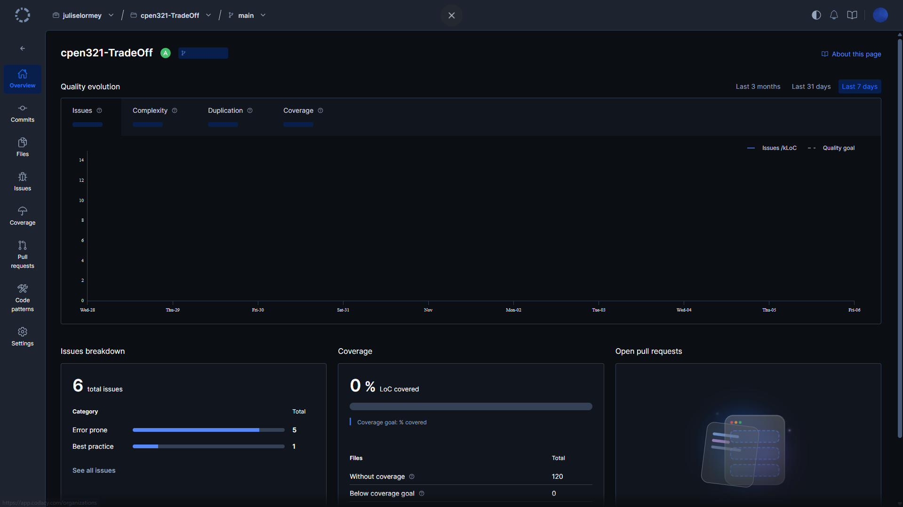
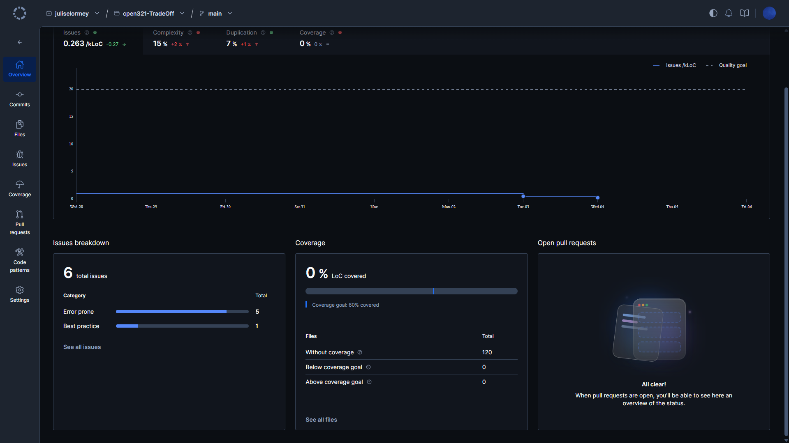
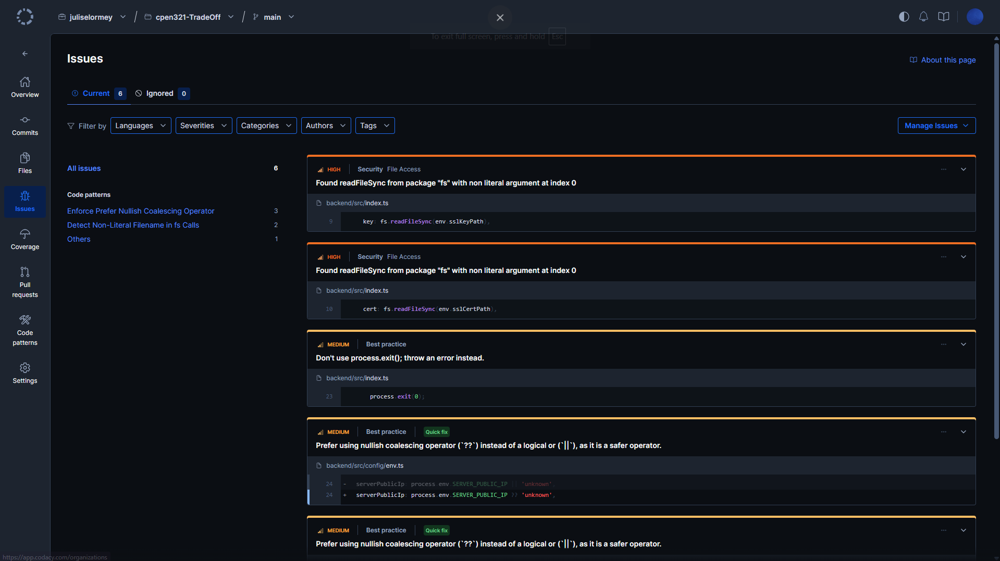
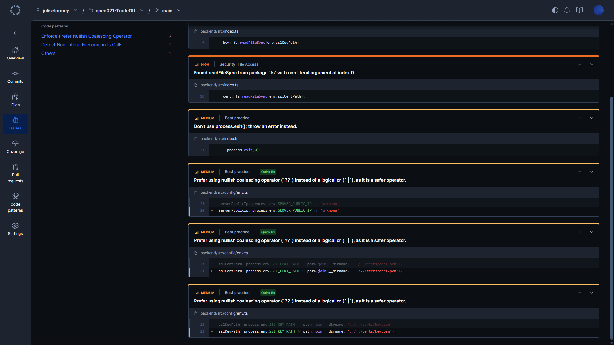

# Code Review

## 1. Change History

| **Change Date** | **Modified Sections** | **Rationale** |
|-----------------| --------------------- | ------------- |
| 2026-11-03      | Automated Code Review Results in response to Codacy information | Filling out the sections for submission to CP2 |
| 2026-11-18 | Section 3.1: Review performed | Record the submitted Excavator review, its scores, major rating-concurrency fault, and supporting PDF/screenshots. |
| 2026-11-18 | Section 2.4: Codacy type-warning investigation | Expand the investigation into per-pattern issues, locations, justifications, and follow-up actions while preserving earlier findings. |

---

## 2. Automated Code Review Results

### 2.1. Commit Hash Where Codacy Ran

`4785596734333930d23872162073d954b9a2d4d2`

### 2.2. Unfixed Issues per Codacy Category

### 2.3. Unfixed Issues per Codacy Code Pattern

### 2.4. Justifications for Unfixed Issues

- **Code Pattern: Unsafe argument of type `any` assigned to a parameter of type `string`.**
    1. **Issue**
        - **Location in Git:** [`../backend/src/market/limitWorker.ts`](../backend/src/market/limitWorker.ts#L14)
        - **Justification:** issue regarding line of code that was already fixed
    2. **Issue**
        - **Location in Git:** [`../backend/src/routes/friends.ts`](../backend/src/routes/friends.ts#L62)
        - **Justification:** issue regarding line of code that was already fixed
- **Code Pattern: Unsafe return of an error typed value.**
    1. **Issue**
        - **Location in Git:** [`../backend/src/market/settlement.ts`](../backend/src/market/settlement.ts#L21)
        - **Justification:** issue regarding line of code that was already fixed
    2. **Issue**
        - **Location in Git:** [`../backend/src/market/settlement.ts`](../backend/src/market/settlement.ts#L38)
        - **Justification:** issue regarding line of code that was already fixed
- **Code Pattern: 'NodeJS' is not defined.**
    1. **Issue**
        - **Location in Git:** [`../backend/src/market/limitWorker.ts`](../backend/src/market/limitWorker.ts#L14)
        - **Justification:** issue regarding line of code that was already fixed
- **Code Pattern: Unexpected empty arrow function.**
    1. **Issue**
        - **Location in Git:** [`../backend/src/market/limitWorker.ts`](../backend/src/market/limitWorker.ts#L54)
        - **Justification:** issue regarding line of code that was already fixed

The additional entries below document the supplied TypeScript warning report.
Line numbers are those reported by Codacy and may differ from the current
working tree. The analyzed commit for these newer warnings was not supplied;
they are not assumed to belong to the historical run in section 2.1. Earlier
entries marked fixed above are retained as historical notes, not newly verified
Codacy results.

- **Code Pattern: `'any' overrides all other types in this union type.`**

    1. **Issue: Prisma Decimal unions lose their type information during analysis.**
        - **Location in Git:** [valuation.ts](../backend/src/market/valuation.ts), reported lines 18, 24, 27, 38, 44, and 58.
        - **Explanation:** The affected declarations use Decimal values together with nullable alternatives. If the analyzer resolves Decimal to `any`, a union such as `Decimal | null` effectively becomes `any`, so it can no longer enforce the intended distinction between a valid numeric value and a missing price.
        - **Investigation:** The [Prisma schema](../backend/src/prisma/schema.prisma) uses the `prisma-client` generator with output `../generated/prisma`. The valuation module imports `Prisma` from that generated client and aliases `Prisma.Decimal`. The generated directory is excluded from Git, so a fresh analysis checkout needs the client generated before it can resolve these types. Local TypeScript typechecking passed with the generated client available.
        - **Justification / current status:** A missing or unresolved generated client is a plausible cause, but Codacy's analysis environment has not been verified. Retaining the Decimal and nullable types preserves the application's intended numeric and missing-data semantics. Replacing them with casts or committing generated files solely to silence the warnings is not justified by the current evidence.
        - **Required follow-up:** Verify that Codacy can resolve the generated client and its runtime dependency types using the intended TypeScript project, then rerun the affected rules. If the warning remains with complete type information, investigate the declaration itself.

- **Code Pattern: Unsafe return of an error typed value.**

    1. **Issue: Production Decimal calculations are reported as having unresolved return types.**
        - **Location in Git:** [valuation.ts](../backend/src/market/valuation.ts), reported line 84.
        - **Explanation:** “Error typed” refers to a type the TypeScript analyzer could not resolve correctly; it does not itself mean the application is returning a JavaScript exception. An unresolved Decimal import can propagate through arithmetic expressions and produce additional warnings at their return sites.
        - **Justification / current status:** The local compiler accepts the Decimal calculation, making a difference in analysis inputs worth investigating before changing working arithmetic. This is not proof that the warning is a false positive: compiler success and lint-rule compliance are different checks.
        - **Required follow-up:** Compare the types inferred locally and in Codacy after confirming the generated client is available. Retain the calculation unless the resolved types or behavior demonstrate an actual defect.

    2. **Issue: Test fixtures and HTTP helpers have unresolved inferred return types.**
        - **Location in Git:** [fixtures.ts](../backend/tests/helpers/fixtures.ts), reported lines 32, 41, 66, 67, 71, 101, 104, and 113; [authApi.test.ts](../backend/tests/mock/authApi.test.ts), line 33; [friendsApi.test.ts](../backend/tests/mock/friendsApi.test.ts), lines 35-37, 44-46, and 86; [marketApi.test.ts](../backend/tests/mock/marketApi.test.ts), lines 45-47; [portfolioApi.test.ts](../backend/tests/mock/portfolioApi.test.ts), lines 9 and 60; [tradesApi.test.ts](../backend/tests/mock/tradesApi.test.ts), lines 10, 67, 68, and 160; [auth.test.ts](../backend/tests/no-mock/auth.test.ts), lines 9 and 36; [friends.test.ts](../backend/tests/no-mock/friends.test.ts), lines 27-30 and 32-34.
        - **Explanation:** These helpers depend on generated Prisma types or third-party test-library types. Missing declarations can propagate through constructor calls, database operations, and Supertest request helpers, causing several warnings from one unresolved dependency.
        - **Justification / current status:** A shared resolution problem is plausible, but each dependency must be checked. The presence of many similar warnings is not sufficient grounds to dismiss them. Adding return annotations alone would not repair an unresolved underlying dependency.
        - **Required follow-up:** Confirm Prisma, Jest, Supertest, and their relevant declaration packages are available to the analyzer and that the test files use the intended compiler configuration. Correct remaining helper signatures where genuine unsafe types persist.

- **Code Pattern: Unsafe return of an `any` typed value.**

    1. **Issue: Backend database-derived results are inferred as `any`.**
        - **Location in Git:** [favorites.ts](../backend/src/routes/favorites.ts), reported line 22; [friends.ts](../backend/src/routes/friends.ts), line 35; [portfolio.ts](../backend/src/routes/portfolio.ts), line 31; [trades.ts](../backend/src/routes/trades.ts), line 113.
        - **Explanation:** If Prisma query results are unresolved, values returned from callbacks or database operations may also become `any`. These warnings concern the loss of static guarantees; they do not alone demonstrate incorrect runtime responses.
        - **Justification / current status:** Check generated query-result types before altering the route logic. If values remain `any` after type resolution is corrected, explicit result types or validation at the relevant boundary may be needed.
        - **Required follow-up:** Recheck the actual return expressions with complete Prisma types. Do not use assertions that merely conceal an unsafe value.

    2. **Issue: Test mock factories return values with insufficient type information.**
        - **Location in Git:** [authApi.test.ts](../backend/tests/mock/authApi.test.ts), reported lines 15 and 19; [friendsApi.test.ts](../backend/tests/mock/friendsApi.test.ts), line 14; [portfolioApi.test.ts](../backend/tests/mock/portfolioApi.test.ts), line 20.
        - **Explanation:** Mock factories and untyped module-loading helpers can genuinely introduce `any`, even when all dependencies resolve. These warnings therefore need separate treatment from the suspected missing-Prisma-type warnings.
        - **Justification / current status:** These findings remain open. Successful test execution does not establish that mock definitions are type-safe, and there is insufficient evidence to label these reports false positives.
        - **Required follow-up:** Where confirmed, provide the actual module type to helpers such as `jest.requireActual` and type mock functions against the interfaces they replace. Preserve test assertions and behavior while improving typing.

- **Code Pattern: Unsafe argument of type `any` assigned to a parameter of type `Iterable<string>`.**

    1. **Issue: The leaderboard price lookup receives a collection whose element types are unresolved.**
        - **Location in Git:** [friends.ts](../backend/src/routes/friends.ts), reported line 34.
        - **Explanation:** The price loader expects ticker strings. If the database-derived collection is inferred as `any`, the analyzer cannot verify that it meets that contract.
        - **Justification / current status:** Inspect the upstream Prisma result first. Casting the collection to `string[]` without resolving or validating its source would hide the warning rather than establish correctness.
        - **Required follow-up:** Confirm that the query and mapping infer ticker strings once generated types are available. If the source is genuinely untyped, add appropriate typing or validation at that source.

- **Code Pattern: Unsafe member access on an `any` value (reported investigation category).**

    1. **Issue: Properties accessed through values with missing or unsafe types cannot be checked.**
        - **Location in Git:** No specific member-access diagnostic location was included in the pasted warning list; obtain the exact Codacy finding before assigning it to a file.
        - **Explanation:** Missing generated types can cause this warning, but so can genuinely untyped objects. The broader investigation mentions this category without enough information to diagnose an individual occurrence.
        - **Justification / current status:** Unverified; no suppression or application-level change is justified for an unidentified occurrence.
        - **Required follow-up:** Record the file, expression, and analyzed commit, then determine whether the value originates from a missing dependency type or an actual untyped boundary.

**Shared investigation evidence and resolution plan**

The [typescript-eslint troubleshooting guidance](https://typescript-eslint.io/troubleshooting/typed-linting/)
explains that missing type information or mismatches between TypeScript projects
can produce misleading `any` and `no-unsafe-*` reports. In particular, excluded
type declarations can resolve to `any`. It recommends aligning the compiler
versions, options, and included files used by the editor, compiler, and linter.

The repository's ESLint configuration selects `./backend/tsconfig.json`.
Verification should confirm that Codacy actually uses that configuration from
the expected project root, with the installed dependency declarations and
generated Prisma Client available. The local typecheck passed, but Codacy's
effective configuration and filesystem have not been inspected.

The supplied investigation states that GitHub Actions runs `npx prisma generate`
before typechecking. No workflow files were present under `.github/workflows`
in this checkout, so that statement still needs confirmation from the relevant
workflow or run log. Even if verified, generation in GitHub Actions would not
by itself prove that a separate Codacy analysis has the generated files.

**Disposition:** Keep these warnings open pending environment verification.
Do not disable the rules, introduce `any` casts, or commit generated files solely
to remove the findings. After resolving any analysis-environment discrepancy,
rerun Codacy and fix genuine remaining type issues. Record the analyzed commit,
configuration, and resulting findings before marking individual issues resolved.

---

## 3. Manual Code Review Results

### 3.1. Review You Performed

- **Peer group reviewed:** Excavator ([repository](https://github.com/ubc-cpen-321-excavator/excavator)).
- **Reviewing group:** TradeOff.
- **Reviewed branch and commit:** `main`, `a5517413ec51e5eafc0b7b469840a4a5b143b3a7`.
- **Report date:** November 17, 2026.
- **Date the artifacts were exchanged:** Not recorded in the supplied report.
- **Review report:** [CP3_Excavator_Review.pdf](reviews/CP3_Excavator_Review.pdf).

The scores and findings below transcribe the submitted report. They concern
Excavator, not TradeOff's own Codacy analysis in section 2. References to peer
source files and line numbers refer to the reviewed version.

| Section | Item | Score |
| --- | --- | --- |
| Manual code review | Code is maintainable, efficient, and handles error cases well | 7/10 |
| Manual test review | Tests cover one end-to-end feature and all interfaces of one component, including errors, edge cases, and correct assertions | 9/10 |
| Manual test review | Test code is maintainable and well-structured | 10/10 |
| Manual test review | Test implementation matches requirements and design | 8/10 |
| Manual test review | Non-functional requirements are tested well | 8/10 |
| Manual test review | Coverage is high and cases below 100% are well-justified | 9/10 |
| Manual test review | All backend tests can run automatically | 10/10 |
| Automated code review | Codacy runs with the required setup | 10/10 |
| Automated code review | Remaining Codacy issues are well-justified | 10/10 |

#### Manual code review findings

- In `GemRepositoryImpl.kt`, the argument around line 49 does not affect the
  resulting API request.
- The add-gem method in the same file, starting around line 85, loses the HTTP
  status and error body, and its TODO does not address other exception types.
- The reviewer found no callers for the method starting around line 131 in
  `GemViewModel.kt`.
- `MainActivity.kt` contains substantial commented-out code.
- The roughly 900-line gem service mixes Place/Gem representation, Google API
  details, and application rules. The report recommends separating these
  responsibilities in accordance with the Single Responsibility Principle and
  separation of concerns.

#### Manual test and automated review findings

- Test folders are well organized, and individual test names are descriptive.
- Some steps in Excavator's `Testing.md` do not match its implemented features;
  the report identifies a leftover “buy milk” to-do example.
- Expired-login tests check rejection by the server but do not verify the
  required navigation back to the sign-in screen.
- Non-functional tests measure server response speed but do not verify when
  updates appear on the screen.
- The report describes coverage as high while noting that a few things failed;
  it does not provide detailed coverage percentages or identify those failures.
- Backend tests run automatically once configured.
- Both automated-review items receive 10/10 in the PDF; it provides no further
  item-specific explanation for those scores.

#### Major fault: concurrent rating submissions overwrite the correct GemScore

**Severity: High.** Two users can successfully rate the same gem concurrently,
but its stored rating count, average, and GemScore can become incorrect. This
violates the requirement that users' ratings be incorporated into the score
and that the score be recomputed after submission.

**Reproduction described in the report:** A reviewer-authored regression test
sends authenticated requests through the backend API using a real temporary
MongoDB database and controls the timing of the updates:

1. User A submits a five-star rating. The backend saves it and calculates count
   1 and average 5.
2. Pause A immediately before its calculated totals are applied to the gem.
3. User B submits a one-star rating. The backend calculates count 2 and average
   3, then saves the corresponding GemScore.
4. Resume A, allowing its earlier calculation to overwrite B's correct result.
5. Read the database after both requests finish. Both return HTTP 200, but the
   stored summary is inconsistent with the two individual ratings.

| Value | Expected | Actual |
| --- | --- | --- |
| Individual ratings | 5 and 1 | 5 and 1 |
| Gem rating count | 2 | 1 |
| Gem average rating | 3 | 5 |
| GemScore | 66 | 68.4 |

**Suspected cause recorded in the report:** Saving the rating, recounting the
ratings, and applying the score are separate operations around lines 65-68 of
the rating service. The gem service saves the score around lines 898-900 without
a version check preventing an older calculation from replacing a newer one.
The PDF uses inconsistent singular/plural service filenames; consult its code
screenshots for the exact references rather than treating those names as
verified repository links.

**Impact:** The API reports success while storing an incorrect gem summary,
potentially showing users misleading scores for a central application feature.

**Evidence:** Pages 3-5 of the [original report](reviews/CP3_Excavator_Review.pdf)
contain the reproduction, expected/actual results, screenshots, and severity
assessment. This documentation update records that evidence; it does not claim
a new reproduction run.

### 3.2. Review You Received

- **Reviewing group:** [WRITE_HERE]
- **Commit SHA that was reviewed:** `[Insert Commit SHA here]`
- **Review report received:** [`<CP#>_<YourGroupName>_Review.pdf`](#)

| **Section**          | **Item**                                                                                                                                             | **Score** |
| -------------------- | ---------------------------------------------------------------------------------------------------------------------------------------------------- | --------- |
| Manual code review   | Code is maintainable, efficient, handles error cases well                                                                                               | x/10      |
| Manual test review   | Tests are complete, errors and edge cases are thoroughly tested, correct assertions are used                                                            | x/10      |
| Manual test review   | Test code is maintainable and well-structured                                                                                                          | x/10      |
| Manual test review   | Test implementation matches the requirements and design                                                                                                | x/10      |
| Manual test review   | Non-functional requirements are tested well                                                                                                            | x/10      |
| Manual test review   | Tests achieve high coverage and cases of < 100% coverage are well-justified                                                                            | x/10      |
| Manual test review   | All back-end tests can be run automatically                                                                                                            | x/10      |
| Automated code review| Codacy runs with the required setup                                                                                                                    | x/10      |
| Automated code review| All remaining Codacy issues are well-justified                                                                                                          | x/10      |

**Major fault reported against your project**

- **Description:** ...
- **Severity:** ...

### 3.3. Actions Taken in Response to the Review

| **Finding** | **Action Taken** | **Commit / Location in Git** |
| ----------- | ---------------- | ---------------------------- |
| ...         | ...              | [`src/...`](#)               |
| ...         | ...              | ...                          |

- **Findings not acted on.** For each finding you decided not to address, give the reason:
    1. **Finding:** ...
        - **Justification:** ...