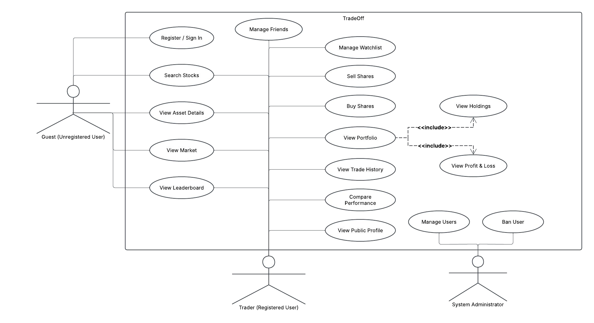
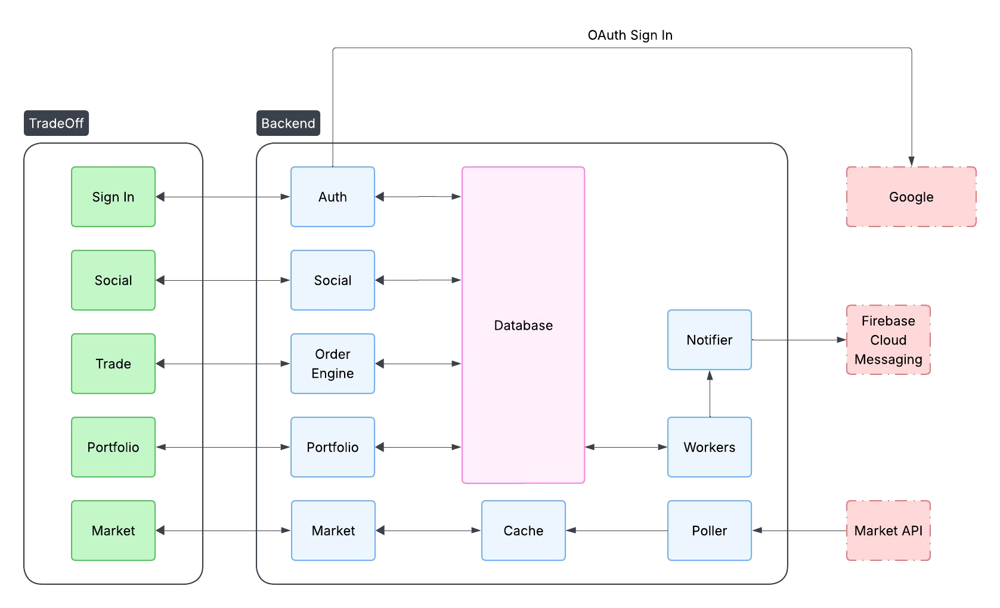

# Requirements and Design

## 1. Change History

| **Change Date** | **Modified Sections** | **Rationale** |
| --- | --- | --- |
| 2026-10-19 | Project description, documented features, actors, use cases, and high-level design | Populate the template using the project idea document and M2 presentation. |

---

## 2. Project Description

**TradeOff - A Competitive Virtual Investing Game** lets users trade stocks with virtual money, build portfolios, and compete against friends using real market data. It is intended for students, young adults, investing beginners, and friends who want to compare their results. Investing can feel complicated, risky, and intimidating; TradeOff turns practice into an interactive game where users can experiment with strategies and learn without risking real money.

Users can invest individually or compete in private investment challenges with an agreed starting amount of virtual money and a set competition period. Real-time portfolio information and leaderboards help users track investments and compare performance. The central technical challenge is representing real stock-market behavior in a playable virtual trading system while keeping market prices and portfolio values updated together.

---

## 3. Requirements Specification

### **3.1. List of Features**

1. **Market/Trading**: Live stock information, stock search, a watchlist, buying and selling shares, and price alerts. The virtual order engine supports the trading functionality.
2. **Portfolio**: Holdings, profit and loss, trade history, and live portfolio/cash-value updates. The portfolio is the central place for users to manage current investments and view their value.
3. **Social**: Public profiles, leaderboards, and copy trading. The use-case diagram also lists managing friends and comparing performance. The project idea describes private investment challenges with friends.
4. **Authentication**: Registration/sign-in through an authentication provider; the high-level design identifies Google.
5. **Administration**: Managing users and banning users, as shown in the M2 use-case diagram. The project idea also describes maintaining app health, user accounts, and system parameters.

**Tentative details in the project idea:** Market, limit, stop, and stop-loss orders are proposed, with an explicit note that order types may change to fit the project scope. Private, local/geographical, and worldwide leaderboards are also proposed. These details are not treated as finalized implementation commitments.

### **3.2. Use Case Diagram**

### **3.3. Actors Description**

1. **Trader (Registered User) - Primary**: Uses TradeOff to practice virtual investing, manage a portfolio, and participate in social competition.
2. **Guest (Unregistered User) - Primary**: An unregistered user identified in M2. The documents do not explicitly define which features guests may access.
3. **System Administrator (Privileged User) - Primary in M2**: Manages users and can ban users. The project idea also identifies responsibility for app health, accounts, and system parameters.
4. **Auth Provider - Secondary**: Provides account authentication. Google is shown as the provider in the high-level design.
5. **Market Data API - Secondary**: Connects TradeOff to stock-market data so virtual investing can reflect real market prices.

### **3.4. Use Case Description**

The following descriptions summarize named capabilities in the supplied documents. Detailed permissions, interaction steps, validation rules, and errors are not specified.

#### Authentication

1. **Register / Sign In**: Register or sign in using the external authentication provider shown in the design.

#### Market/Trading

2. **View Market**: View stock-market information based on real market data.
3. **Search Stocks**: Search for stocks within the market/trading feature.
4. **View Asset Details**: View information about a selected asset, as listed in the use-case diagram.
5. **Manage Watchlist**: Bookmark stocks and manage the watchlist. The project idea describes watchlist CRUD operations through the UI.
6. **Buy Shares**: Buy shares using virtual money through the virtual order engine.
7. **Sell Shares**: Sell shares through the virtual order engine as part of virtual trading.
8. **Price Alerts**: Receive stock-price alerts, a capability listed in M2. Alert thresholds, configuration, and delivery behavior are not specified.

#### Portfolio

9. **View Portfolio**: View the user's investments and cash value, with live updates described in the project idea.
10. **View Holdings**: View current investments within the portfolio.
11. **View Profit & Loss**: View portfolio profit and loss.
12. **View Trade History**: View the history of virtual trades.

#### Social

13. **Manage Friends**: Manage friends, as listed in the use-case diagram. Specific operations are not defined.
14. **View Leaderboard**: View rankings to compare investing performance with other users.
15. **Compare Performance**: Compare investing results, as listed in the use-case diagram and project idea.
16. **View Public Profile**: View a user's public profile. The fields and visibility rules are not specified.
17. **Copy Trading**: A social capability named in M2. The documents do not specify its workflow or execution rules.
18. **Compete in Private Investment Challenges**: Compete with friends using an agreed starting virtual balance over a set time period, as described in the project idea. Creation, joining, and scoring procedures are not specified.

#### Administration

19. **Manage Users**: Administer user accounts, as listed in the use-case diagram.
20. **Ban User**: Ban a user, as listed in the use-case diagram. Conditions and consequences are not specified.

### **3.5. Formal Use Case Specifications (5 Most Major Use Cases)**

### **3.6. Screen Mock-ups**

### **3.7. Non-Functional Requirements**

---

## 4. Designs Specification

### **4.1. Main Components**

The following elements appear in the M2 high-level design. Their purposes below are limited to the labels, connections, and feature descriptions in the supplied documents. Component-selection rationales and interface names, parameters, return values, and error contracts are not specified.

| **Component** | **Documented responsibility or connection** |
| --- | --- |
| **Auth** | Supports sign-in; connects to the database and Google. |
| **Social** | Supports the social feature; connects to the frontend Social area and the database. |
| **Order Engine** | Supports virtual buying, selling, and trading; connects to the frontend Trade area and the database. Multiple order types are proposed in the project idea, subject to scope changes. |
| **Portfolio** | Supports investment holdings and portfolio value; connects to the frontend Portfolio area and the database. |
| **Market** | Supports real-market information; connects to the frontend Market area and the cache. |
| **Cache** | Appears between Market and Poller in the design. Cache technology, contents, and expiration policy are not specified. |
| **Poller** | Appears between the Market API and Cache. Polling interval and request behavior are not specified. |
| **Workers** | Connects to the database and sends to Notifier in the diagram. Specific jobs and scheduling are not specified. |
| **Notifier** | Connects to Firebase Cloud Messaging and receives from Workers. Specific notification rules and payloads are not specified. |

### **4.2. Databases**

1. **Database**
   - **Purpose**: The high-level design shows a shared database connected to Auth, Social, Order Engine, Portfolio, and Workers.
   - **Technology, schema, and selection rationale**: Not specified in the supplied documents.

### **4.3. External Modules**

1. **Google**
   - **Purpose**: External authentication provider connected to Auth in the high-level design.
2. **Market API**
   - **Purpose**: Supplies real stock-market data; shown connected to Poller in the high-level design. The provider is not named.
3. **Firebase Cloud Messaging**
   - **Purpose**: External messaging service connected to Notifier in the high-level design. No other Firebase functionality is specified.

External API signatures, configuration, and reasons for selecting particular providers are not specified.

### **4.4. Frameworks and Libraries**

Not specified in the two supplied project documents. External services explicitly named in the architecture are listed in Section 4.3; no additional libraries or implementation technologies are assumed.

### **4.5. Dependencies Diagram**

The original diagram groups the frontend into Sign In, Social, Trade, Portfolio, and Market, and shows the backend elements, database, and external services listed above. It is preserved as supplied; no additional dependencies or interface definitions are added.

### **4.6. Use Case Sequence Diagram (5 Most Major Use Cases)**

Not provided in the supplied documents. Their high-level design does not specify the ordered calls or interface contracts needed to reproduce sequence diagrams without making additional decisions.

### **4.7. Design of Non-Functional Requirements**

Not specified in the supplied documents. No implementation mechanisms or measurable non-functional acceptance criteria are supplied.
