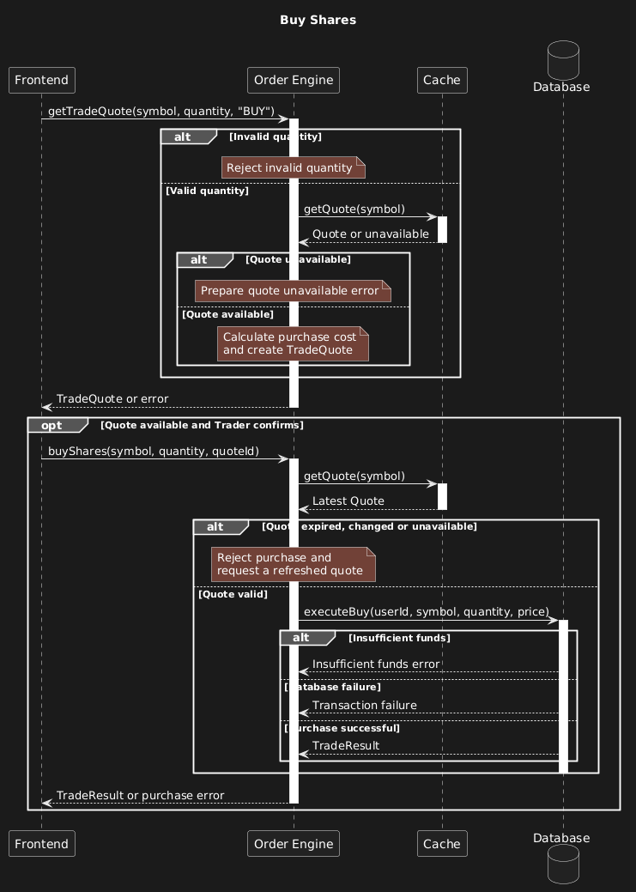
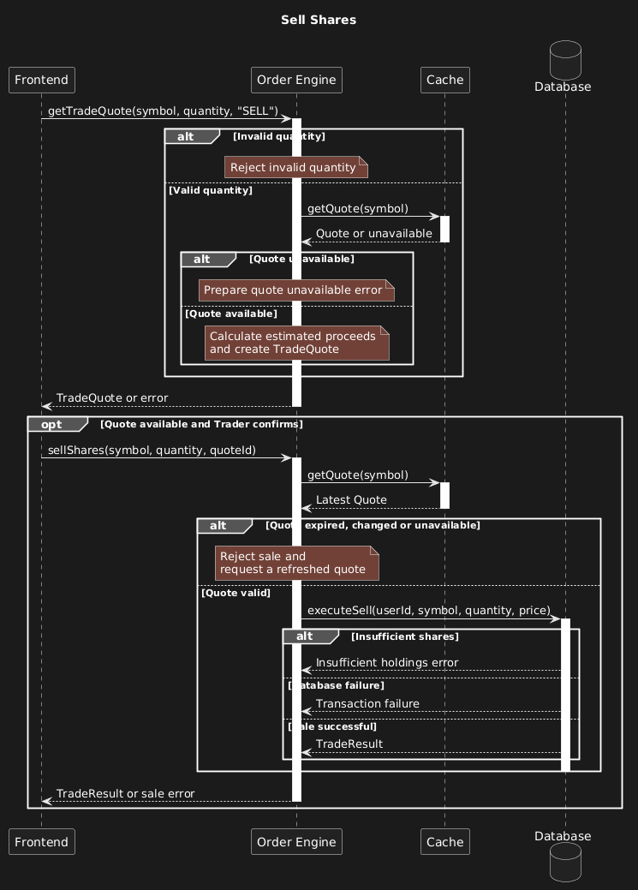
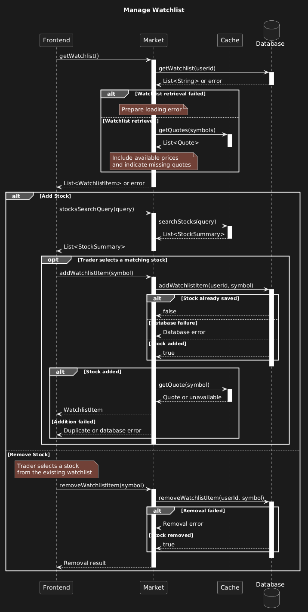
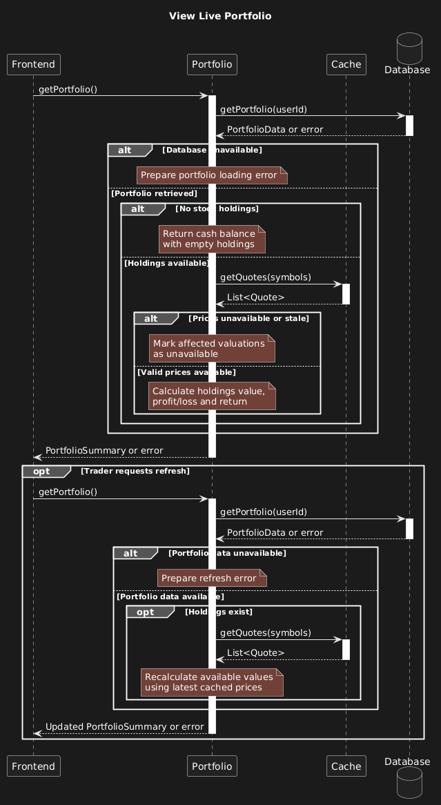
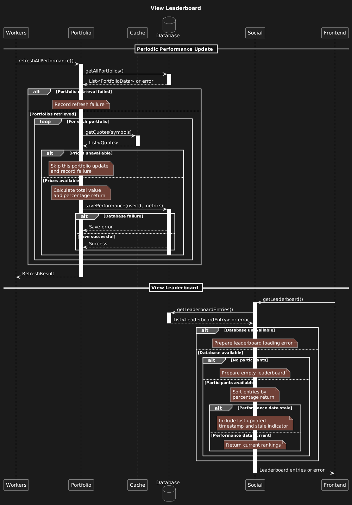

# Requirements and Design

## 1. Change History

| **Change Date** | **Modified Sections**                                                              | **Rationale**                                  |
| --------------- | ---------------------------------------------------------------------------------- | ---------------------------------------------- |
| 2026-10-19      | Project description, documented features, actors, use cases, and high-level design | Filling out the sections for submission to CP1 |

---

## 2. Project Description

**TradeOff - A Competitive Virtual Investing Game** lets users trade stocks with virtual money, build portfolios, and compete against friends using real market data. It is intended for students, young adults, investing beginners, and friends who want to compare their results. Investing can feel complicated, risky, and intimidating; TradeOff turns practice into an interactive game where users can experiment with strategies and learn without risking real money.

Users can invest individually or compete in private investment challenges with an agreed starting amount of virtual money and a set competition period. Real-time portfolio information and leaderboards help users track investments and compare performance. The central technical challenge is representing real stock-market behavior in a playable virtual trading system while keeping market prices and portfolio values updated together.

---

## 3. Requirements Specification

### **3.1. List of Features**

1. **Market/Trading**: Live stock information, stock search, a watchlist, buying and selling shares, and price alerts. The virtual order engine supports the trading functionality.
2. **Portfolio**: Holdings, profit and loss, trade history, and live portfolio/cash-value updates. The portfolio is the central place for users to manage current investments and view their value.
3. **Social**: Public profiles, leaderboards, and copy trading. The use-case diagram also lists managing friends and comparing performance. The project idea describes private investment challenges with friends.
4. **Authentication**: Registration/sign-in through an authentication provider; the high-level design identifies Google.
5. **Administration**: Managing users and banning users, as shown in the M2 use-case diagram. The project idea also describes maintaining app health, user accounts, and system parameters.

**Tentative details in the project idea:** Market, limit, stop, and stop-loss orders are proposed, with an explicit note that order types may change to fit the project scope. Private, local/geographical, and worldwide leaderboards are also proposed. These details are not treated as finalized implementation commitments.

### **3.2. Use Case Diagram**

### **3.3. Actors Description**

1. **Trader (Registered User) - Primary**: Uses TradeOff to practice virtual investing, manage a portfolio, and participate in social competition.
2. **Guest (Unregistered User) - Primary**: An unregistered user identified in M2. The documents do not explicitly define which features guests may access.
3. **System Administrator (Privileged User) - Primary in M2**: Manages users and can ban users. The project idea also identifies responsibility for app health, accounts, and system parameters.
4. **Auth Provider - Secondary**: Provides account authentication. Google is shown as the provider in the high-level design.
5. **Market Data API - Secondary**: Connects TradeOff to stock-market data so virtual investing can reflect real market prices.

### **3.4. Use Case Description**

#### Authentication

1. **Register / Sign In**: Register or sign in using the external authentication provider shown in the design.

#### Market/Trading

2. **View Market**: View stock-market information based on real market data.
3. **Search Stocks**: Search for stocks within the market/trading feature.
4. **View Asset Details**: View information about a selected asset, as listed in the use-case diagram.
5. **Manage Watchlist**: Bookmark stocks and manage the watchlist. The project idea describes watchlist CRUD operations through the UI.
6. **Buy Shares**: Buy shares using virtual money through the virtual order engine.
7. **Sell Shares**: Sell shares through the virtual order engine as part of virtual trading.
8. **Price Alerts**: Receive stock-price alerts, a capability listed in M2. Alert thresholds, configuration, and delivery behavior are not specified.

#### Portfolio

9. **View Portfolio**: View the user's investments and cash value, with live updates described in the project idea.
10. **View Holdings**: View current investments within the portfolio.
11. **View Profit & Loss**: View portfolio profit and loss.
12. **View Trade History**: View the history of virtual trades.

#### Social

13. **Manage Friends**: Manage friends, as listed in the use-case diagram. Specific operations are not defined.
14. **View Leaderboard**: View rankings to compare investing performance with other users.
15. **Compare Performance**: Compare investing results, as listed in the use-case diagram and project idea.
16. **View Public Profile**: View a user's public profile. The fields and visibility rules are not specified.
17. **Copy Trading**: A social capability named in M2. The documents do not specify its workflow or execution rules.
18. **Compete in Private Investment Challenges**: Compete with friends using an agreed starting virtual balance over a set time period, as described in the project idea. Creation, joining, and scoring procedures are not specified.

#### Administration

19. **Manage Users**: Administer user accounts, as listed in the use-case diagram.
20. **Ban User**: Ban a user, as listed in the use-case diagram. Conditions and consequences are not specified.

### **3.5. Formal Use Case Specifications (5 Most Major Use Cases)**

| **Use Case**        | **Success Flow**                                                                                                                                                             | **Failure Scenarios**                                                                                                                |
| ------------------- | ---------------------------------------------------------------------------------------------------------------------------------------------------------------------------- | ------------------------------------------------------------------------------------------------------------------------------------ |
| Buy Shares          | User selects a stock and quantity → app displays a quote → user confirms → backend validates and executes the virtual purchase → cash, holdings, and trade history update.   | Invalid quantity; insufficient cash; unavailable or stale quote; database failure. A failed purchase leaves the portfolio unchanged. |
| Sell Shares         | User selects a holding and quantity → app displays a quote → user confirms → backend validates ownership and executes the sale → cash, holdings, and history update.         | Insufficient shares; invalid quantity; unavailable quote; database failure.                                                          |
| View Live Portfolio | User searches for a stock → adds it → stock appears in their watchlist → user can later remove it.                                                                           | Unknown symbol; duplicate entry; save failure.                                                                                       |
| Manage Watchlist    | User opens their portfolio → backend retrieves holdings and market prices → calculates values and profit/loss → app displays them and refreshes when new prices arrive.      | Market data unavailable; connection lost. Display the last available values with their timestamp and indicate that they are stale.   |
| View Leaderboard    | d User opens a leaderboard → backend calculates portfolio values using a consistent price snapshot → ranks participants → app displays the rankings and the user’s position. | No participants; unavailable prices; request failure.                                                                                |

### **3.6. Screen Mock-ups**

### **3.7. Non-Functional Requirements**

1. **Trade Consistency**
   - **Description**: When 20 buy or sell requests execute concurrently against the same account, cash balances and share quantities must remain non-negative. Each trade must either update cash, holdings, and trade history completely or leave all three unchanged.
   - **Justification**: Concurrent requests could otherwise spend the same virtual money or sell the same shares multiple times. Twenty concurrent requests provide a manageable stress-test target for conflicting operations on one account.

2. **Portfolio Update Speed**
   - **Description**: While the portfolio screen is open, updated holdings valuations must appear within 10 seconds after the backend receives a new market quote, under normal network connectivity.
   - **Justification**: Timely updates help users understand how market movements affect their investments. The 10-second target supports responsive gameplay while allowing periodic refreshes; measuring from backend receipt excludes delays caused by the external market-data provider.

3. **Account Privacy**
   - **Description**: Every protected portfolio, watchlist, and trade-history API must reject unauthenticated requests and attempts to read or modify another user's private data, without disclosing that data or changing it.
   - **Justification**: Users must only access and modify their own private investment information. This requirement applies to every protected interface because a single unprotected interface could bypass the application's account restrictions.

---

## 4. Designs Specification

### **4.1. Main Components**

The following elements appear in the M2 high-level design. Their purposes below are limited to the labels, connections, and feature descriptions in the supplied documents. Component-selection rationales and interface names, parameters, return values, and error contracts are not specified.

| **Component**    | **Documented responsibility or connection**                                                                                                                                           |
| ---------------- | ------------------------------------------------------------------------------------------------------------------------------------------------------------------------------------- |
| **Auth**         | Supports sign-in; connects to the database and Google.                                                                                                                                |
| **Social**       | Supports the social feature; connects to the frontend Social area and the database.                                                                                                   |
| **Order Engine** | Supports virtual buying, selling, and trading; connects to the frontend Trade area and the database. Multiple order types are proposed in the project idea, subject to scope changes. |
| **Portfolio**    | Supports investment holdings and portfolio value; connects to the frontend Portfolio area and the database.                                                                           |
| **Market**       | Supports real-market information; connects to the frontend Market area and the cache.                                                                                                 |
| **Cache**        | Appears between Market and Poller in the design. Cache technology, contents, and expiration policy are not specified.                                                                 |
| **Poller**       | Appears between the Market API and Cache. Polling interval and request behavior are not specified.                                                                                    |
| **Workers**      | Connects to the database and sends to Notifier in the diagram. Specific jobs and scheduling are not specified.                                                                        |
| **Notifier**     | Connects to Firebase Cloud Messaging and receives from Workers. Specific notification rules and payloads are not specified.                                                           |

### **4.2. Databases**

1. **MySQL**
   - **Purpose**: Store user accounts, virtual cash balances, holdings, trade history, watchlists, and social relationships. The database will support the Auth, Social, Order Engine, Portfolio, and Workers components.
   - **Rationale**: MySQL supports structured relationships and constraints between users, holdings, and trades. Its transactions allow cash balances, holdings, and trade history to be updated together, preventing partially completed trades.
   - **Access**: Backend components will access MySQL. The frontend will retrieve and modify data through backend interfaces rather than connecting directly to the database.

### **4.3. External Modules**

1. **Google Authentication**
   - **Purpose**: Allow users to sign in using their Google accounts. The Auth component will verify Google authentication credentials and associate the verified identity with a user account stored in MySQL.
   - **Rationale**: Provides external authentication without using Firebase Authentication.

2. **Market Data API**
   - **Purpose**: Supply stock prices and market information for stock searches, virtual trading, and portfolio valuation. The Poller component will retrieve market data and update the cache.
   - **Provider**: To be selected.
   - **Rationale**: Real market data allows users to practice virtual investing using prices that reflect actual markets.

3. **Firebase Cloud Messaging (FCM)**
   - **Purpose**: Deliver push notifications, such as stock-price alerts, to users' Android devices through the Notifier component.
   - **Rationale**: The course permits Firebase's push notification functionality. Firebase will not be used for authentication, database management, or other application operations.

### **4.4. Frameworks and Libraries**

1. **Jetpack Compose**
   - **Purpose**: Build the Android application's user interface.
   - **Reason**: Required by the course and supports screens that react to changes in application state.

2. **Express.js**
   - **Purpose**: Implement backend API routes and request handling.
   - **Reason**: Provides a straightforward framework for organizing the Node.js/TypeScript backend.

3. **Retrofit and OkHttp**
   - **Purpose**: Handle HTTP communication between the Android application and backend.
   - **Reason**: Provide structured API definitions and configurable network connections.

4. **Android Credential Manager and Google ID**
   - **Purpose**: Support Google account sign-in.
   - **Reason**: Integrate external authentication with Android without using Firebase Authentication.

5. **Socket.IO and ws**
   - **Purpose**: Support real-time communication and WebSocket connections.
   - **Reason**: Allow the system to exchange updates through persistent connections.

6. **Prisma (Planned)**
   - **Purpose**: Define database models, manage migrations, and access MySQL from the backend.
   - **Reason**: Provides typed database queries and transactions for consistent updates.

7. **Firebase Cloud Messaging SDK (Planned)**
   - **Purpose**: Send and receive push notifications.
   - **Reason**: Supports Android notifications and is the Firebase functionality permitted by the course.

8. **Jest and Supertest**
   - **Purpose**: Run automated backend tests and verify HTTP API behavior.
   - **Reason**: Support repeatable testing and coverage measurement.

9. **Compose Testing APIs**
   - **Purpose**: Automate interactions with Android Compose screens.
   - **Reason**: Support verification of user flows through the application.

### **4.5. Dependencies Diagram**

The original diagram groups the frontend into Sign In, Social, Trade, Portfolio, and Market, and shows the backend elements, database, and external services listed above. It is preserved as supplied; no additional dependencies or interface definitions are added.

### **4.6. Use Case Sequence Diagram (5 Most Major Use Cases)**

#### 1. Buy Shares

#### 2. Sell Shares

#### 3. Manage Watchlist

#### 4. View Live Portfolio

#### 5. View Leaderboard

### **4.7. Design of Non-Functional Requirements**

1. **Trade Consistency**
   - **Implementation**: The Order Engine will use Prisma transactions with MySQL to update cash balances, holdings, and trade history together. Conditional updates and transaction isolation will prevent concurrent orders from spending the same balance or selling the same shares. If any operation fails, the transaction will be rolled back.

2. **Portfolio Update Speed**
   - **Implementation**: When the backend receives new market quotes, it will recalculate affected portfolio valuations and send updates to connected clients through Socket.IO. The frontend will apply these updates while the portfolio screen is open, targeting display within 10 seconds of backend receipt. Quote timestamps will identify stale data when the connection is interrupted.

3. **Account Privacy**
   - **Implementation**: Authentication middleware will verify credentials before allowing access to protected APIs. Backend components will derive the requesting user's identity from verified credentials and enforce ownership checks before reading or modifying private portfolios, watchlists, or trade history. Unauthorized requests will be rejected without disclosing or changing private data.
