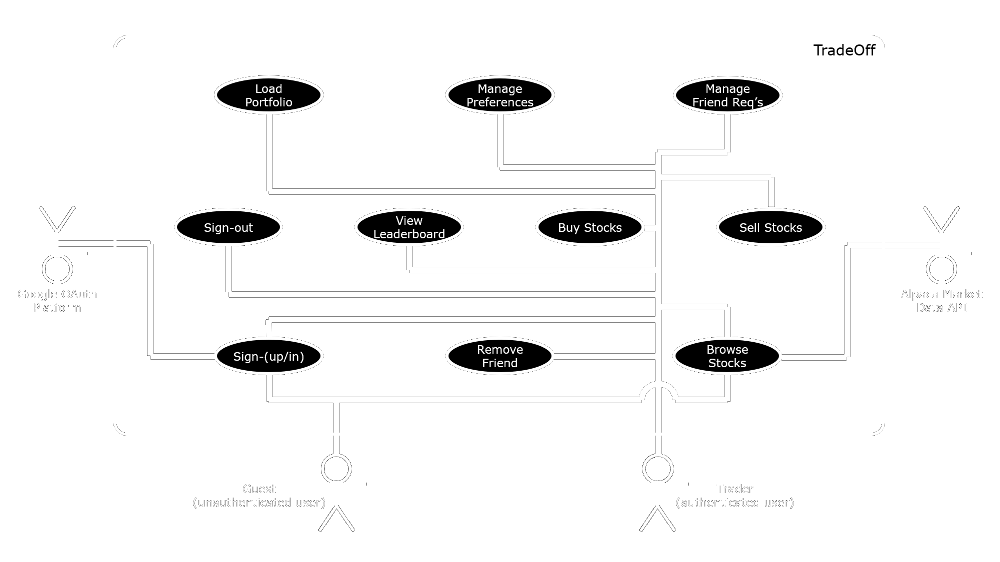
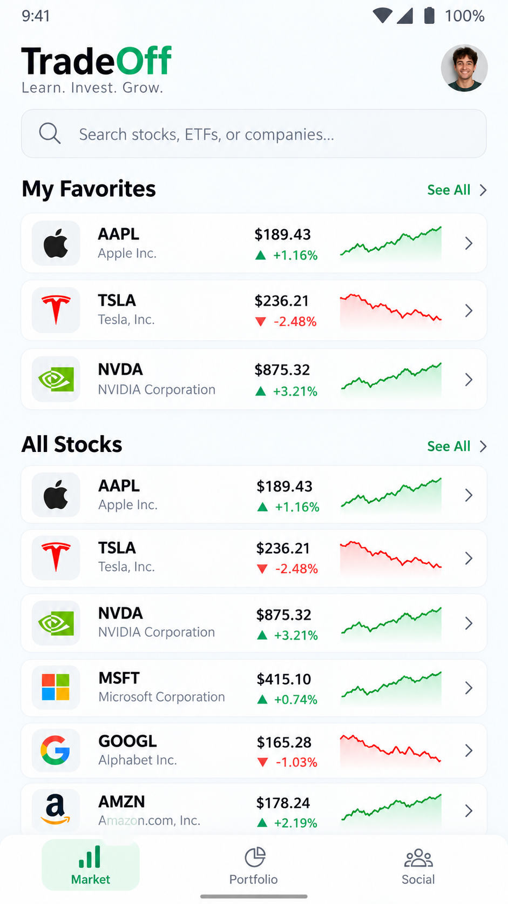
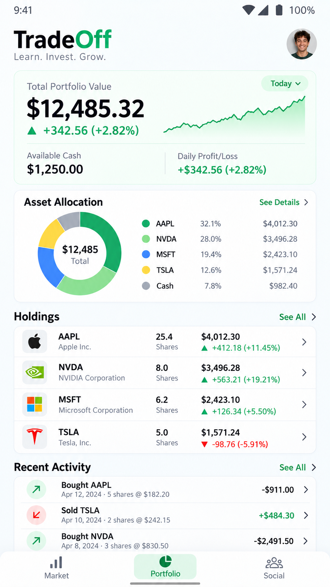
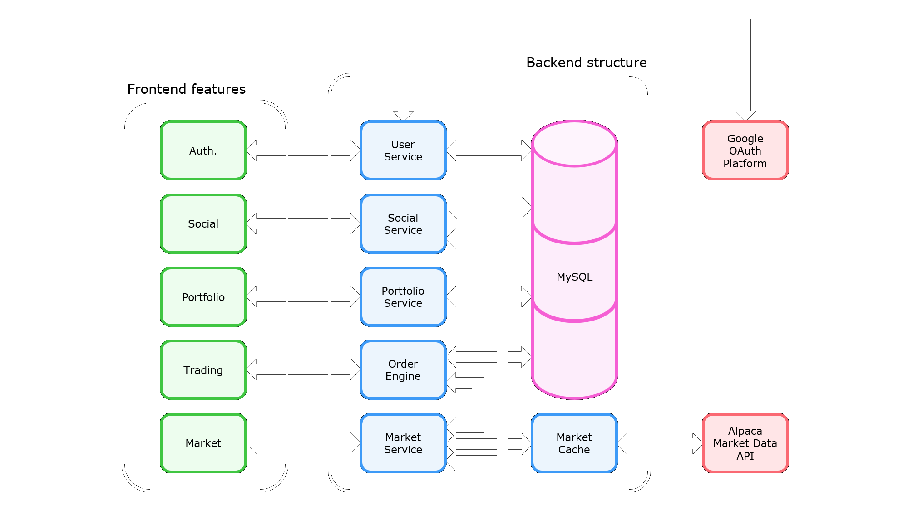
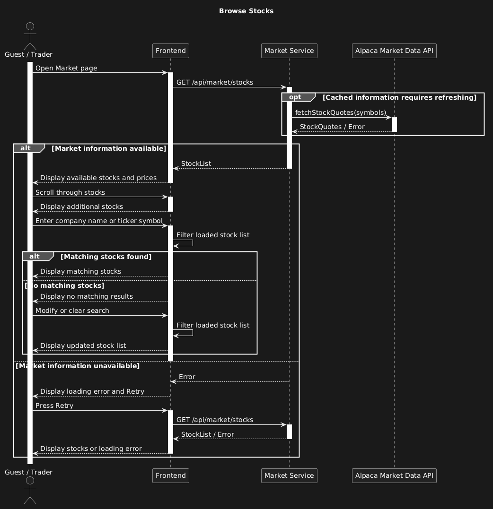
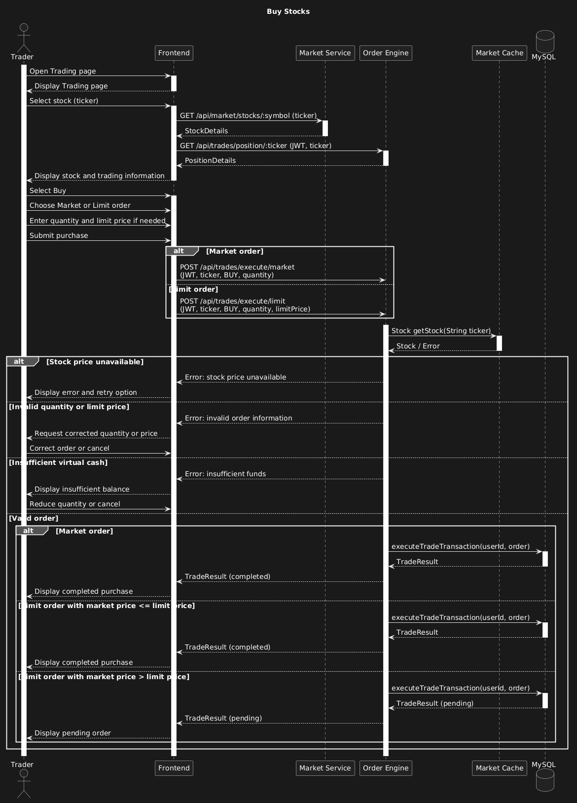
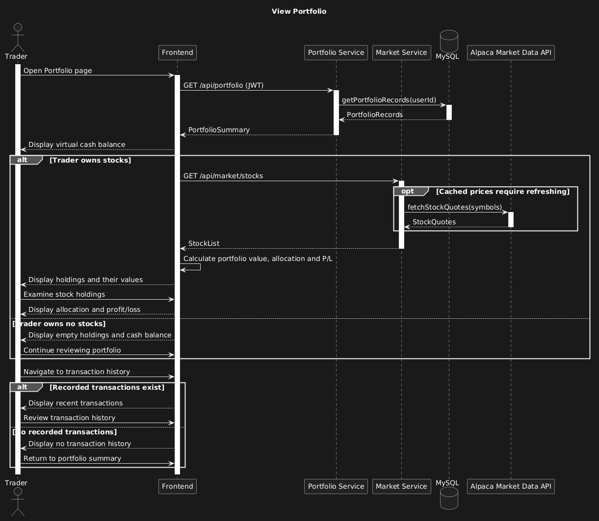
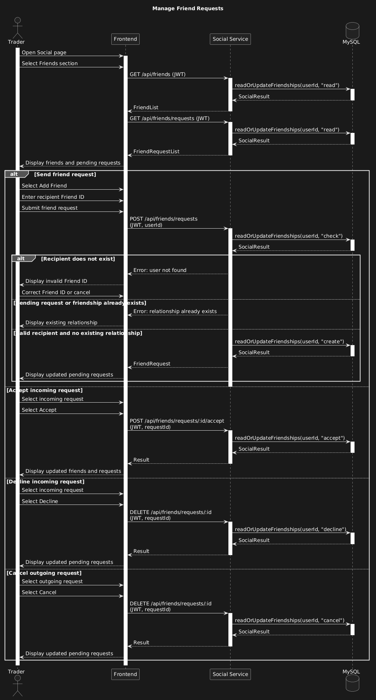
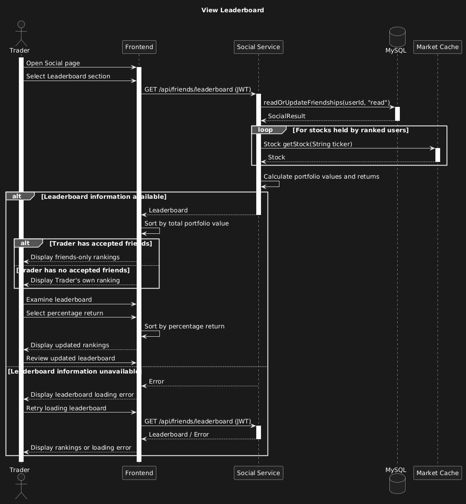

# Requirements and Design

## 1. Change History

| **Change Date** | **Modified Sections**                                                              | **Rationale**                                  |
| --------------- | ---------------------------------------------------------------------------------- | ---------------------------------------------- |
| 2026-10-19      | Project description, documented features, actors, use cases, and high-level design | Filling out the sections for submission to CP1 |
| 2026-11-01      | Everything concerning requirements, features, use cases, components, interfaces and the like (2.0, 3.1, 3.2, 3.3, 3.4, 3.5, 3.6, 3.7, 4.1, 4.2, 4.3, 4.4, 4.5, 4.6, 4.7) | Filling out the sections for submission to CP2 |
| 2026-11-03      | Continuation of changes on 2026-11-01 (3.2, 3.4, 3.5, 4.1, 4.3, 4.4, 4.5, 4.6, 4.7) | In response to CP2 submission, backend changes, and TA feedback |

---

## 2. Project Description

> [!CAUTION]
> notes for revision go here

*TradeOff* is a competitive virtual investing game, which lets users trade stocks with virtual money, build portfolios, and compete against friends using real market data. It is intended for students, young adults, investing beginners, and friends who want to compare their results. Investing can feel complicated, risky, and intimidating; TradeOff turns that practice into an interactive game where users can experiment with strategies and learn without risking real money.

Users can practice virtual stock trading using virtual funds, and in real-time see the effects of the market, holding changes, and profits/losses. Real-time portfolio information and leaderboards help users track investments and compare performance between themselves, or against friends. The central technical challenge is representing real stock-market behavior in a playable virtual trading system while keeping market prices and portfolio values updated together.

---

## 3. Requirements Specification

> [!CAUTION]
> changing user preferences and stuff like that would be another feature entirely (DO NOT MERGE IT WITH AUTH)

### **3.1. List of Features**

1. **Authentication** - Registration and signins happen through the Google authentication service, which then links to a personal virtual trading account and profile-specific settings (such as managing account info, app preferences, signing out).
2. **Market** - Live market information retrieved from the Alpaca Market Data API which includes browsing and searching through current stock prices and their changes, with updates being cached ~every 8 seconds.
3. **Trading** - People can buy or sell shares using virtual money through a trading system, which governs validating funds and shares, updating account balances and stock positions, and recording transactions completed.
4. **Portfolio** - View your personal virtual investment portfolio through its respective screen, including available cash, held stocks, total portfolio value, allocation of assets, profits and losses, and transaction history.
5. **Social** - People can send, cancel, accept and decline friend requests between other users, and compare statistics with accepted friends, displaying rankings that can be sorted in a leaderboard.

### **3.2. Use Case Diagram**

> [!CAUTION]
> notes for revision go here

### **3.3. Actors Description**

> [!CAUTION]
> notes for revision go here

1. **[primary] Guest (unauthenticated user)** - One who has no TradeOff account. All of the user interface is barred for this user except for market data (which they cannot act on...).
2.  **[primary] Trader (authenticated user)** - One who has a TradeOff account. They can thus act on market data, execute trading, use social features, have a logged history viewable by portfolio, among other app capabilities.
3. **[secondary] Google Authentication Service - Secondary**: Provides account authentication, specifically the verification of TradeOff accounts by linking them to certain Google accounts.
4. **[secondary] Alpaca Market Data API - Secondary**: Bridges TradeOff with necessary stock market data to emulate an investment platform (maybe be more specific?)

### **3.4. Use Case Description**

> [!CAUTION]
> if it branches at all they should probably be different use cases
> 
> "manage" = implies adding, creating, deleting. maybe "edit pref."?

1. **[authentication] Sign-up/Sign-in** - Authenticating through the Google Sign-in Interface. If the account doesn't have a linked TradeOff account, one will be created and linked for them.
2. **[authentication] Sign-out** - Clears authentication for users who are signed in, clearing the session from their TradeOff account and returning them to an unauthenticated user.
3. **[authentication] Manage Preferences** - View and edit account and application information, including changing profile name and username, or changing application appearance (e.g. light/dark mode). TradeOff will save the changed info accordingly.
4. **[market] Browse Stocks** - Move though available stocks or use a search bar to view stocks by their company name or ticker symbol. TradeOff shows matching stocks and available market info.
5. **[trading] Buy Stocks** - Select a stock, specify how much of that stock, and choose to buy using the virtual funds. User balance and shares are updated and the trade is recorded.
6. **[trading] Sell Stocks** - Select an owned stock, specify how much of that stock you have, and choose to sell. User balance and shares are updated and the trade is recorded.
7. **[portfolio] Load Portfolio** - View your cash balance, stock holdings, total value, asset allocations, profits and losses, and transaction history. The Portfolio page of the app will present all this information.
8. **[social] Manage Friend Requests** - Send friend requests to other TradeOff users. One can also accept, decline, or cancel pending requests. TradeOff updates itself depending on the response.
9. **[social] Remove Friend** - Users can remove an existing friend from their friend list. TradeOff will take notice of the removal request and will remove info regarding that friendship.
10. **[social] View Leaderboard** - View rankings comparing portfolio value and percentage return between friends. The leaderboard can be reordered or filtered to emphasize a certain criterion.

### **3.5. Formal Use Case Specifications (5 Most Major Use Cases)**

> [!CAUTION]
> notes for revision go here

1. **Browse Stocks**
   - Description: Move though available stocks or use a search bar to view stocks by their company name or ticker symbol. TradeOff shows matching stocks and available market info.
   - Primary Actor(s): Guest, Trader
   - Preconditions:
      - Actor(s) are allowed to open the Market page
   - Postconditions:
      - Actor(s) have viewed available stock information
   - Main Success Scenario:
      - (1) Actor opens the Market page
      - (2) System displays the available stocks and their market information
      - (3) Actor scrolls through the available stocks
      - (4) Actor enters a company name or ticker symbol into the search bar
      - (5) System filters the stock list according to the search input
      - (6) Actor views matching stocks and their displayed market information
   - Some Failure Scenarios:
      - (2a) Market information is unavailable.
         - (2a1) System indicates that the stock information could not be loaded.
         - (2a2) Actor presses Retry to retry loading the market info.
      - (5a) No stocks match the search input.
         - (5a1) System displays no matching results.
         - (5a2) Actor modifies or clears the search input.
         - (5a3) System updates the displayed stock list, returning to step 5.

2. **Buy Stocks**
   - Description: Select a stock, specify how much of that stock, and choose to buy using virtual funds through a market or limit order. User balance and shares are updated when the purchase is completed, and the trade is recorded.
   - Primary Actor(s): Trader
   - Preconditions:
      - Trader is authenticated and has access to the Trading page
      - Trader has sufficient virtual cash to purchase the selected shares
   - Postconditions:
      - Trader's virtual cash balance and stock holdings reflect the completed purchase
      - The completed purchase is recorded in the Trader's transaction history
   - Main Success Scenario:
      - (1) Trader opens the Trading page
      - (2) Trader selects a stock to trade
      - (3) System displays the selected stock and its trading information
      - (4) Trader selects the Buy option
      - (5) Trader chooses a market order or limit order
      - (6) Trader enters the number of shares to purchase (and a limit price if needed)
      - (7) Trader submits the purchase
      - (8) System validates the quantity and available/needed virtual cash
      - (9) System executes the purchase and updates the Trader's cash balance and stock holdings
      - (10) System records the completed transaction and displays the trade result
   - Some Failure Scenarios:
      - (8a) Trader has insufficient virtual cash for the purchase.
         - (8a1) System rejects the purchase and informs the Trader that their available balance is insufficient
         - (8a2) Trader reduces the purchase quantity and returns to step 7, or cancels the purchase
      - (8b) Trader enters an invalid quantity.
         - (8b1) System rejects the purchase and indicates that the entered quantity is invalid
         - (8b2) Trader corrects the quantity and returns to step 7, or cancels the purchase
      - (8c) Stock price information is unavailable.
         - (8c1) System rejects the purchase and informs the Trader that the stock price could not be retrieved
         - (8c2) Trader retries the purchase later or cancels it
      - (8d) Trader enters a limit order where the price is lower than the market price.
         - (5a6) Otherwise, System creates a pending order and reserves the required virtual cash
         - (5a7) System displays the pending order, which can be completed or cancelled later

3. **View Portfolio**
   - Description: View your cash balance, stock holdings, total value, asset allocations, profits and losses, and transaction history. The Portfolio page of the app will present all this information.
   - Primary Actor(s): Trader
   - Preconditions:
      - Actor(s) are allowed to open the Portfolio page
   - Postconditions:
      - Trader has viewed their available portfolio information
      - No changes have been made to the Trader's cash balance or stock holdings
   - Main Success Scenario:
      - (1) Trader opens the Portfolio page
      - (2) System displays the Trader's virtual cash balance and portfolio summary
      - (3) Trader examines their displayed stock holdings
      - (4) System presents the holdings' values and asset allocation
      - (5) Trader examines the displayed total portfolio value and profit/loss information
      - (6) Trader navigates to the transaction history section
      - (7) System displays the Trader's recorded transactions
      - (8) Trader reviews the transaction history
   - Some Failure Scenarios:
      - (3a) Trader does not own any stocks.
         - (3a1) System displays an empty holdings section while continuing to show the Trader's virtual cash balance
         - (3a2) Trader continues reviewing their portfolio or navigates to the Trading page to purchase shares
      - (7a) Trader has no recorded transactions.
         - (7a1) System indicates that no transaction history is available
         - (7a2) Trader returns to the portfolio summary or navigates to the Trading page

4. **Manage Friend Requests**
   - Description: Send friend requests to other TradeOff users. One can also accept, decline, or cancel pending requests. TradeOff updates itself depending on the response.
   - Primary Actor(s): Trader
   - Preconditions:
      - Trader is authenticated and has a TradeOff account
      - Trader has access to the Social page
   - Postconditions:
      - A new friend request is pending, or an existing request has been accepted, declined, or cancelled
      - Friendship info of the involved actor(s) reflect this
   - Main Success Scenario:
      - (1) Trader opens the Social page
      - (2) Trader selects the Friends section
      - (3) System displays the Trader's existing friends and pending friend requests
      - (4) Trader chooses to add a friend
      - (5) Trader identifies another TradeOff user to send a friend request to by friend ID
      - (6) Trader submits the friend request
      - (7) System checks whether the receiver exists and a friendship between them doesn't
      - (8) System creates a pending friend request
      - (9) System updates the displayed request information
   - Some Failure Scenarios:
      - (5a) The requested user does not exist.
         - (5a1) System informs the Trader that the requested user could not be found
         - (5a2) Trader corrects the user information and returns to step 5, or cancels the request
      - (7a) A pending friend request or accepted friendship already exists.
         - (7a1) System prevents the duplicate request and indicates the existing relationship
         - (7a2) Trader returns to the Friends section without creating another request
      - (4a) Trader chooses to accept an incoming friend request instead.
         - (4a1) Trader selects an incoming pending friend request
         - (4a2) Trader chooses Accept
         - (4a3) System updates the relationship to an accepted friendship
         - (4a4) System updates the friends and pending requests lists
      - (4b) Trader chooses to decline an incoming friend request instead.
         - (4b1) Trader selects an incoming pending friend request
         - (4b2) Trader chooses Decline
         - (4b3) System removes the pending friend request
         - (4b4) System updates the pending requests list
      - (4c) Trader chooses to cancel an outgoing friend request instead.
         - (4c1) Trader selects an outgoing pending friend request
         - (4c2) Trader chooses Cancel
         - (4c3) System removes the pending friend request
         - (4c4) System updates the pending requests list

5. **View Leaderboard**
   - Description: View rankings comparing portfolio value and percentage return between friends. The leaderboard can be reordered or filtered to emphasize a certain criterion.
   - Primary Actor(s): Trader
   - Preconditions:
      - Actor(s) are allowed to open the Social page
   - Postconditions:
      - Trader has viewed the available leaderboard rankings
   - Main Success Scenario:
      - (1) Trader opens the Social page
      - (2) Trader selects the Leaderboard section
      - (3) System retrieves leaderboard information for the Trader and their accepted friends
      - (4) System displays users ranked (by default it's total portfolio value)
      - (5) Trader examines the displayed rankings
      - (6) Trader selects a different ranking criterion (e.g. % portfolio return)
      - (7) System reorders the leaderboard according to the selected criterion
      - (8) Trader reviews the updated rankings
   - Some Failure Scenarios:
      - (3a) Trader has no accepted friends.
         - (3a1) System displays the Trader's own leaderboard information without comparisons to friends
         - (3a2) Trader continues viewing their information or navigates to the Friends section to send friend requests
      - (3b) Leaderboard information cannot be retrieved.
         - (3b1) System indicates that leaderboard information is unavailable
         - (3b2) Trader revisits or refreshes the Leaderboard section to retry the request

### **3.6. Screen Mock-ups**

> [!CAUTION]
> notes for revision go here

| **Prospective Market screen mockup** | **Prospective Portfolio screen mockup** |
| --- | --- |
|  |  |

### **3.7. Non-Functional Requirements**

> [!CAUTION]
> make these make more sense for the app + its users
> 
> ground the values in somethiing realistic (+ check for android apps specifically)

1. **Response-Time Consistency**
   - **Description**: When tested by a single user, at least 95% of requests to each of TradeOff's three Market API endpoints must complete within 1 second, measured over at least 100 requests per endpoint with the required data cached.
   - **Justification**: TradeOff supports multiple market-data operations, including stock browsing, individual stock lookup, and historical price retrieval. Measuring response times separately for each endpoint ensures that acceptable performance is maintained across these operations rather than allowing faster requests to conceal slower ones.

2. **Concurrent-Load Efficiency**
   - **Description**: Under a workload of 10 simultaneous simulated users, at least 95% of cached Market API requests must complete within 1 second, with no requests failing due to server overload, measured over at least 100 requests.
   - **Justification**: TradeOff is a multi-user trading application, so its market-data service must remain responsive when users browse stocks simultaneously. The 1-second limit follows the same usability guideline as NFR 1, while 10 concurrent users defines a manageable initial workload for evaluating this project's shared backend rather than claiming production-scale capacity.

3. **External-Service Reliability**
   - **Description**: After a simulated temporary Alpaca API outage, TradeOff must automatically resume retrieving updated market data within two eligible market-refresh intervals (~16s) after Alpaca becomes available again, without restarting the application or backend.
   - **Justification**: TradeOff depends on Alpaca for market information, making recovery from temporary provider interruptions VERY important. TradeOff's market refreshes happen every 8 seconds, so two refresh periods allows for some lenience, but a window small enough to ensure TradeOff can reliably come back on time.

---

## 4. Designs Specification

### **4.1. Main Components**

> [!CAUTION]
> match the template (match interfaces w/ components
> 
> do not list external or database here
> 
> market cache should not be split (only if it's for all APIs)
> 
> when implementing push notifs, make a versatile notif service

| **Component** | **Documented responsibility or connection** |
| --- | --- |
| **User Service** | Handles authentication verification, account creation and retrieval, and user information. Centralizing these responsibilities allows other services to rely on a consistent authenticated user identity. |
| **Social Service** | Manages friend requests, friendships, and leaderboard information stored in the database. Separating social logic keeps relationship management independent of trade execution and market-data retrieval. |
| **Portfolio Service** | Retrieves account holdings and transaction information and is intended to calculate portfolio valuations using market prices. Different from the Order Engine, reviewing investments and executing trades are different. |
| **Order Engine** | Processes virtual buy and sell requests and updates the associated cash balances, holdings, and transaction records. Centralizing trade execution supports consistent validation and database updates. |
| **Market Service** | Retrieves stock information from Alpaca and provides market-data endpoints to the application. Centralizing market-data access avoids requiring each feature to communicate independently with the external provider. |
| **Market Cache** | Stores recently retrieved market information to reduce repeated external API requests. Caching the data saves calling costs, and gives safe data to the Market Service and Portfolio Service. |
| **(extern) Google OAuth Platform** | Provides external identity authentication for TradeOff users. Using Google avoids implementing a separate password-based authentication system while allowing TradeOff to maintain its own application accounts. |
| **(extern) Alpaca Market Data API** | Supplies external stock-market information used by TradeOff's Market functionality. This service is imperative because TradeOff aims to emulate real market information rather than making fake market data. |
| **(database) MySQL** | Delivers application notifications through itself. Separating notification delivery from functional services would allow notification behavior to be managed independently when implemented. |

| **Interface** | **From** | **To** | **Purpose** |
| --- | --- | --- | --- |
| `POST /api/auth/google (idToken) → AuthResponse` | Frontend (Auth.) | User Service | Verifies Google credentials, retrieves or creates a user account, and issues a TradeOff auth token. |
| `GET /api/users/me (JWT) → UserProfile` | Frontend (Auth.) | User Service | Retrieves the authenticated user's profile information. |
| `PATCH /api/users/me (JWT, profileChanges) → UserProfile` | Frontend (Auth.) | User Service | Updates supported user profile fields. |
| `GET /api/market/stocks → StockList` | Frontend (Market) | Market Service | Retrieves the available stock listings and market information. |
| `GET /api/market/stocks/:symbol (symbol) → StockDetails` | Frontend (Market) | Market Service | Retrieves stock details and the latest available quote. |
| `GET /api/market/stocks/:symbol/history (symbol) → PriceHistory` | Frontend (Market) | Market Service | Retrieves historical prices for a selected stock. |
| `GET /api/market/stocks → StockList` | Frontend (Portfolio) | Market Service | Retrieves stock prices used by the frontend to calculate portfolio valuations. |
| `POST /api/trades/execute (JWT, ticker, side, type, quantity, limitPrice) → TradeResult` | Frontend (Trading) | Order Engine | Executes a virtual buy or sell order after validating available funds or holdings. |
| `POST /api/trades/execute/market (JWT, ticker, side, quantity) → TradeResult` | Frontend (Trading) | Order Engine | Executes a market buy or sell order using a server-obtained stock price. |
| `POST /api/trades/execute/limit (JWT, ticker, side, quantity, limitPrice) → TradeResult` | Frontend (Trading) | Order Engine | Places a limit buy or sell order, which may be completed immediately or remain pending. |
| `GET /api/trades/position/:ticker (JWT, ticker) → PositionDetails` | Frontend (Trading) | Order Engine | Retrieves the user's available cash and stock holdings for a selected stock. |
| `GET /api/trades/orders/pending (JWT) → PendingOrders` | Frontend (Trading) | Order Engine | Retrieves the user's pending orders. |
| `POST /api/trades/orders/:id/cancel (JWT, orderId) → CancelResult` | Frontend (Trading/Portfolio) | Order Engine | Cancels a pending order and releases reserved funds when applicable. |
| `GET /api/portfolio (JWT) → PortfolioSummary` | Frontend (Portfolio) | Portfolio Service | Retrieves cash balances, holdings, recent trades, and pending orders. |
| `GET /api/friends (JWT) → FriendList` | Frontend (Social) | Social Service | Retrieves the user's accepted friendships. |
| `GET /api/friends/requests (JWT) → FriendRequestList` | Frontend (Social) | Social Service | Retrieves pending friend requests. |
| `POST /api/friends/requests (JWT, userId) → FriendRequest` | Frontend (Social) | Social Service | Sends a friend request to another user. |
| `POST /api/friends/requests/:id/accept (JWT, requestId) → Result` | Frontend (Social) | Social Service | Accepts a pending friend request. |
| `DELETE /api/friends/requests/:id (JWT, requestId) → Result` | Frontend (Social) | Social Service | Declines an incoming friend request. |
| `DELETE /api/friends/requests/:id (JWT, requestId) → Result` | Frontend (Social) | Social Service | Cancels an outgoing friend request. |
| `DELETE /api/friends/:id (JWT, friendshipId) → Result` | Frontend (Social) | Social Service | Removes an existing friendship. |
| `GET /api/friends/leaderboard (JWT) → Leaderboard` | Frontend (Social) | Social Service | Retrieves friends-only rankings based on total portfolio value and percentage returns. |
| `Stock getStock(String ticker)` | Order Engine | Market Cache | Supplies stock prices for validating and executing virtual orders. |
| `Stock getStock(String ticker)` | Social Service | Market Cache | Supplies stock prices for calculating leaderboard portfolio values. |
| `fetchStockQuotes(symbols) → StockQuotes` | Market Service | Alpaca Market Data API | Retrieves current market quotes from Alpaca. |
| `fetchPriceHistory(symbol) → PriceHistory` | Market Service | Alpaca Market Data API | Retrieves historical market prices from Alpaca. |
| `verifyIdToken(idToken) → GoogleIdentity` | User Service | Google Authentication | Validates a Google ID token and retrieves the verified identity. |
| `findOrCreateUser(googleIdentity) → User` | User Service | MySQL | Retrieves or creates an account associated with a verified Google identity. |
| `readOrUpdateFriendships(userId, operation) → SocialResult` | Social Service | MySQL | Retrieves or updates friendship and friend-request records. |
| `executeTradeTransaction(userId, order) → TradeResult` | Order Engine | MySQL | Atomically updates virtual cash, holdings, orders, and trade history. |
| `getPortfolioRecords(userId) → PortfolioRecords` | Portfolio Service | MySQL | Retrieves records needed to display portfolio information. |

### **4.2. The Database**

> [!CAUTION]
> notes for revision go here

1. **MySQL** - Stores user accounts, virtual cash balances, holdings, trade history, watchlists, social relationships, information for other components, among other data - Chosen as MySQL is popular in supporting the needed data, and in updating said data concurrently, avoiding errors such as partial trades.

### **4.3. External Modules**

> [!CAUTION]
> notes for revision go here

1. **Google Authentication** - Allows safe linkage between TradeOff and Google accounts - Chosen so we can authenticate in our app without using Firebase.
2. **Alpaca Market Data API** - Supplies stock prices and market information for stock searches, virtual trading, and portfolio valuation - Chosen because real market data will help the app reflect normal markets, its main purpose!

### **4.4. Frameworks and Libraries**

> [!CAUTION]
> notes for revision go here

1. **Jetpack Compose** - Builds the user interface - Chosen as it's required by the course and supports screens that react to changes in application state.
2. **Express.js** - Implements backend API routes and request-handling - Chosen as it's straightforward in organizing the Node.js/TypeScript backend.
3. **Retrofit + OkHttp** - Handles HTTP communication between the frontend and backend - Chosen as it provides structured API definitions and customizable connection.
4. **Android Credential Manager** - Support for things relevant to Google sign-in - Chosen so we can authenticate in our app without using Firebase.
6. **Prisma** - Defines database models, manages migrations, and accesses MySQL from the backend - Chosen for typed database queries and transactions for consistent updates.
7. **Jest and Supertest** - Runs automated backend tests and verifies HTTP API behavior - Chosen for constant and consistent testing of endpoints and backend code w/ coverage.
8. **Compose Testing APIs** - Automates interactions with Android Compose screens - Chosen to support verification of user flows through TradeOff.

### **4.5. Dependencies Diagram**

> [!CAUTION]
> frontend fetches auth token and backend uses it
>
> math with the template more than you do now

### **4.6. Use Case Sequence Diagrams (5 Most Major Use Cases)**

> [!CAUTION]
> for alt boxes, wait to get a response then act on it w/ the cases

| **Browse Stocks** | **Buy Stocks** | **View Portfolio** | **Manage Friend Requests** | **View Leaderboard** |
| --- | --- | --- | --- | --- |
|  |  |  |  |  |

### **4.7. Design of Non-Functional Requirements**

> [!CAUTION]
> notes for revision go here

1. **Response-Time Consistency**
   - **Implementation**: A performance test will send at least 100 sequential requests to any relevant API endpoints (e.g. market/stocks, stocks/:symbol, and :symbol/history). Response times will be recorded separately for each endpoint, and each must achieve a 95th-percentile response time (i.e. response time 95% of requests fall under) under one second.

2. **Concurrent-Load Efficiency**
   - **Implementation**: A load test will simulate 10 users issuing at least 100 requests concurrently against cached Market API endpoints. The test will calculate the 95th-percentile response time (i.e. the time 95% of response times fall under) and check for holdups caused by server overload.

3. **External-Service Reliability**
   - **Implementation**: An automated test will simulate an Alpaca outage, restore successful API responses, allow any configured retry cooldown to expire, and verify that updated market data is retrieved within two eligible refresh intervals without restarting either component.
