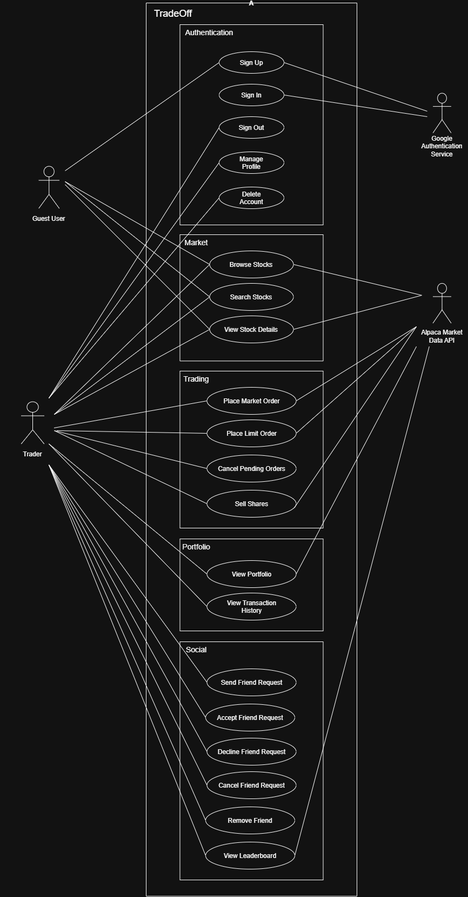
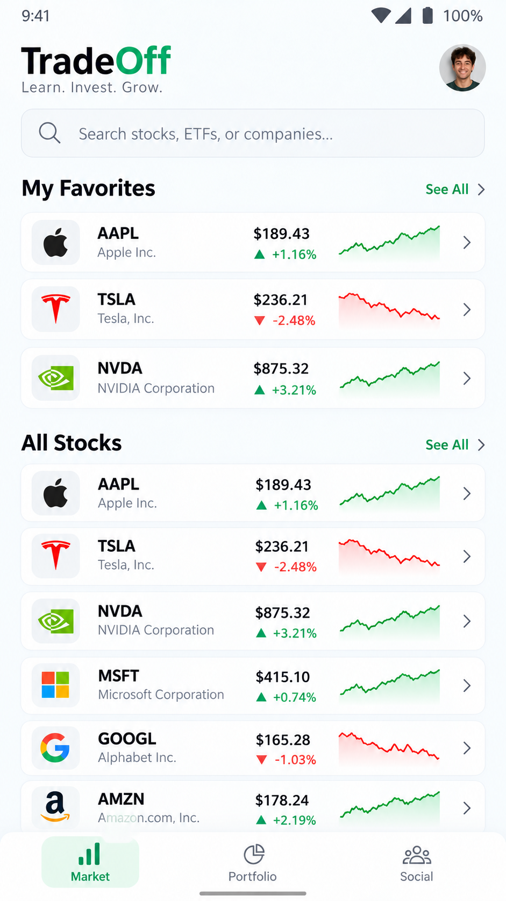
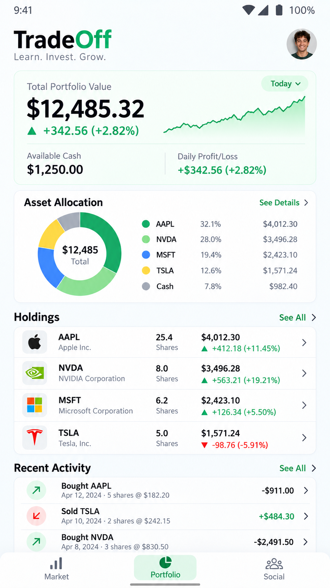
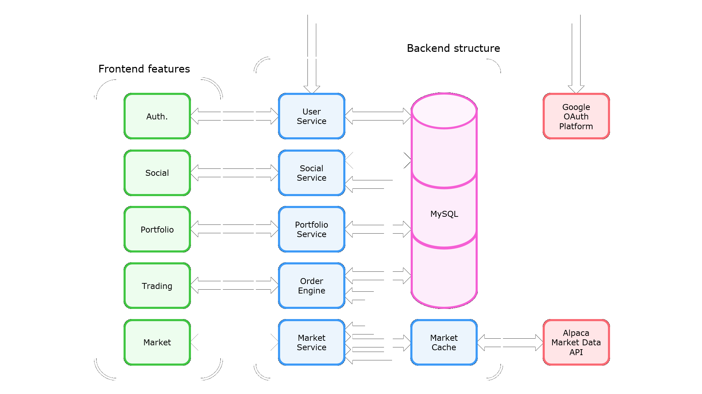
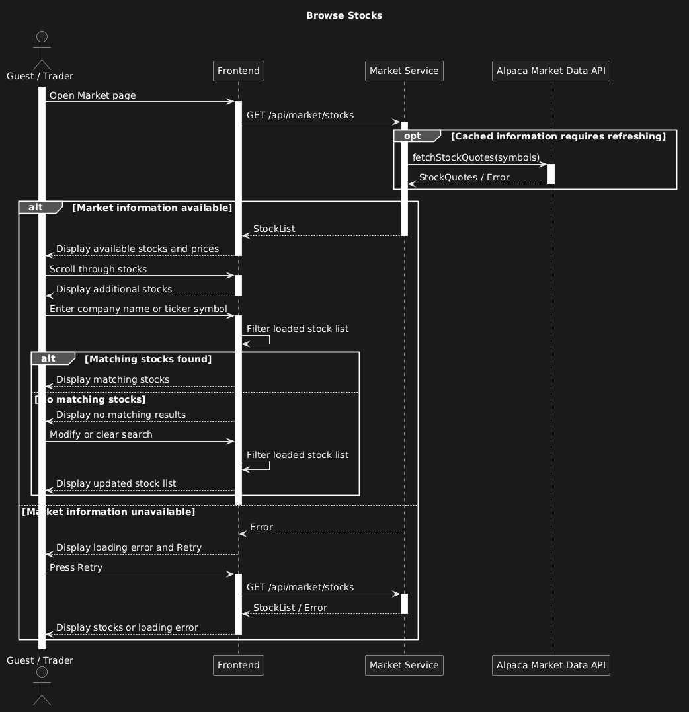
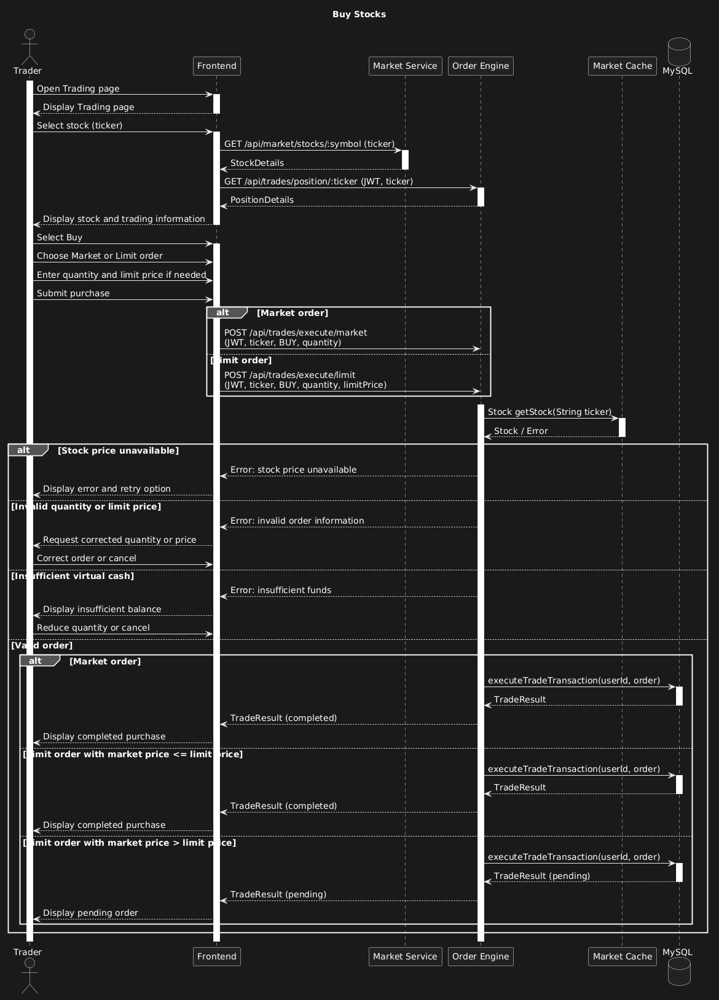
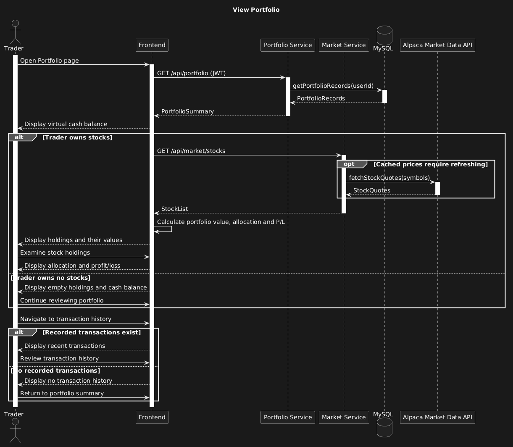
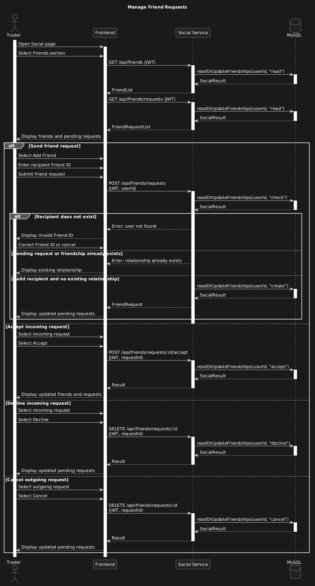
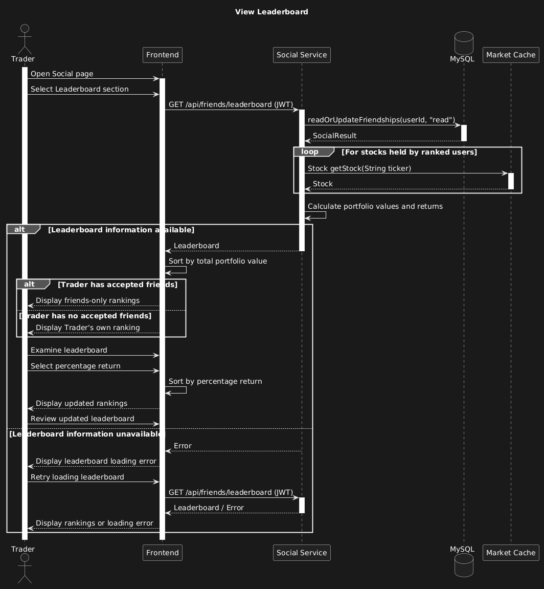

# Requirements and Design

## 1. Change History

| **Change Date** | **Modified Sections**                                                              | **Rationale**                                  |
| --------------- | ---------------------------------------------------------------------------------- | ---------------------------------------------- |
| 2026-10-19      | Project description, documented features, actors, use cases, and high-level design | Filling out the sections for submission to CP1 |
| 2026-11-01      | Everything concerning requirements, features, use cases, components, interfaces and the like (2.0, 3.1, 3.2, 3.3, 3.4, 3.5, 3.6, 3.7, 4.1, 4.2, 4.3, 4.4, 4.5, 4.6, 4.7) | Filling out the sections for submission to CP2 |
| 2026-11-03      | Continuation of changes on 2026-11-01 (3.2, 3.4, 3.5, 4.1, 4.3, 4.4, 4.5, 4.6, 4.7) | In response to CP2 submission, backend changes, and TA feedback |

---

## 2. Project Description

*TradeOff* is a competitive virtual investing game, which lets users trade stocks with virtual money, build portfolios, and compete against friends using real market data. It is intended for students, young adults, investing beginners, and friends who want to compare their results. Investing can feel complicated, risky, and intimidating; TradeOff turns that practice into an interactive game where users can experiment with strategies and learn without risking real money.

Users can practice virtual stock trading using virtual funds, and in real-time see the effects of the market, holding changes, and profits/losses. Real-time portfolio information and leaderboards help users track investments and compare performance between themselves, or against friends. The central technical challenge is representing real stock-market behavior in a playable virtual trading system while keeping market prices and portfolio values updated together.

---

## 3. Requirements Specification

### **3.1. List of Features**

1. **Authentication** - Registration and signins happen through the Google authentication service, which then links to a personal virtual trading account and profile-specific settings (such as managing account info, app preferences, signing out).
2. **Market** - Live market information retrieved from the Alpaca Market Data API which includes browsing and searching through current stock prices and their changes, with updates being cached ~every 8 seconds.
3. **Trading** - People can buy or sell shares using virtual money through a trading system, which governs validating funds and shares, updating account balances and stock positions, and recording transactions completed.
4. **Portfolio** - View your personal virtual investment portfolio through its respective screen, including available cash, held stocks, total portfolio value, allocation of assets, profits and losses, and transaction history.
5. **Social** - People can send, cancel, accept and decline friend requests between other users, and compare statistics with accepted friends, displaying rankings that can be sorted in a leaderboard.

### **3.2. Use Case Diagram**

### **3.3. Actors Description**

1. **[primary] Guest (unauthenticated user)** - One who has no TradeOff account. All of the user interface is barred for this user except for market data (which they cannot act on...).
2.  **[primary] Trader (authenticated user)** - One who has a TradeOff account. They can thus act on market data, execute trading, use social features, have a logged history viewable by portfolio, among other app capabilities.
3. **[secondary] Google Authentication Service - Secondary**: Provides account authentication, specifically the verification of TradeOff accounts by linking them to certain Google accounts.
4. **[secondary] Alpaca Market Data API - Secondary**: Bridges TradeOff with necessary stock market data to emulate an investment platform (maybe be more specific?)

### **3.4. Use Case Description**

1. **[authentication] Sign-up** - A new user authenticates through the Google Sign-in Interface. TradeOff creates a new account linked to that Google account, with starting virtual cash.
2. **[authentication] Sign-in** - A returning user authenticates through the Google Sign-in Interface and is signed in to their existing linked TradeOff account.
3. **[authentication] Sign-out** - A signed-in user ends their session, and TradeOff returns them to an unauthenticated state.
4. **[authentication] Manage Profile** - A signed-in user views and edits their profile name and username. TradeOff saves the changes.
5. **[authentication] Delete Account** - A signed-in user permanently deletes their TradeOff account, and TradeOff removes the account and its associated data.
6. **[market] Browse Stocks** - View the list of available stocks and their current market information.
7. **[market] Search Stocks** - Enter a company name or ticker symbol into the search bar to filter the stock list. TradeOff shows the matching stocks.
8. **[market] View Stock Details** - Select a stock to view its latest quote and price history chart.
9. **[trading] Place Market Order** - Select a stock and a number of shares, and buy at the current market price using virtual funds. TradeOff updates the user’s cash and shares and records the trade.
10. **[trading] Place Limit Order** - Select a stock, a number of shares, and a limit price. If the limit allows an immediate fill, TradeOff completes the purchase; otherwise TradeOff creates a pending order and reserves the required cash.
11. **[trading] Sell Shares** -  Select an owned stock and a number of shares up to the amount owned, and sell at the market price or a limit price. TradeOff updates the user’s cash and shares and records the trade.
12. **[trading] Cancel Pending Orders** - Cancel a pending limit order. TradeOff removes the order and releases any cash reserved for it.
13. **[portfolio] View Portfolio** - View cash balance, stock holdings, total value, asset allocation, profit and loss, and pending orders on the Portfolio page.
14. **[portfolio] View Transaction History** - View the list of the user’s completed trades.
15. **[social] Send Friend Request** - Send a friend request to another TradeOff user by their friend ID. TradeOff creates a pending request.
16. **[social] Accept Friend Request** - Accept an incoming pending request. TradeOff creates the friendship and updates both users’ lists.
17. **[social] Decline Friend Request** - Decline an incoming pending request. TradeOff removes the request.
18. **[social] Cancel Friend Request** - Cancel a request the user sent that is still pending. TradeOff removes the request.
19. **[social] Remove Friend** - Remove an existing friend from the friend list. TradeOff removes the friendship for both users.
20. **[social] View Leaderboard** - View a ranking of the user and their accepted friends by total portfolio value or percentage return, and reorder it by either criterion.
### **3.5. Formal Use Case Specifications (5 Most Major Use Cases)**

1. **Browse Stocks**
    - Description: View the list of available stocks and their current market information.
    - Primary Actor(s): Guest, Trader
    - Preconditions:
        - Actor(s) are allowed to open the Market page
    - Postconditions:
        - Actor(s) have viewed the available stocks and their market information
        - No changes have been made to any account data
    - Main Success Scenario:
        - (1) Actor opens the Market page
        - (2) System retrieves the current stock list and quotes
        - (3) System displays each stock's name, ticker, logo, current price, and price change
        - (4) Actor scrolls through the available stocks
    - Some Failure Scenarios:
        - (2a) Market information cannot be retrieved.
            - (2a1) System responds with an error, and the app displays a message that market information could not be loaded, with a Retry button
            - (2a2) Actor presses Retry
            - (2a3) System retries the request, returning to step 2

2. **Place Market Buy**
    - Description: Select a stock and a number of shares, and buy at the current market price using virtual funds. User balance and shares are updated and the trade is recorded.
    - Primary Actor(s): Trader
    - Preconditions:
        - Trader is authenticated and has access to the Trading page
    - Postconditions:
        - Trader's virtual cash is reduced by the cost of the purchase, and their holding of the stock is increased by the purchased shares
        - The completed purchase is recorded in the Trader's transaction history
    - Main Success Scenario:
        - (1) Trader opens the Trading page
        - (2) Trader selects a stock to trade
        - (3) System displays the selected stock, its current price, and the Trader's available cash
        - (4) Trader selects the Buy option and chooses a market order
        - (5) Trader enters the number of shares to purchase
        - (6) Trader submits the order
        - (7) System obtains the current price from market data
        - (8) System validates the quantity and verifies that the Trader has enough virtual cash
        - (9) System executes the purchase and updates the Trader's cash balance and stock holdings
        - (10) System records the transaction and displays the trade result
    - Some Failure Scenarios:
        - (7a) The current stock price cannot be retrieved.
            - (7a1) System rejects the order and informs the Trader that the stock price could not be retrieved
            - (7a2) Trader retries the order, returning to step 6, or cancels it
        - (8a) The quantity is invalid.
            - (8a1) System rejects the order and indicates that the entered quantity is invalid
            - (8a2) Trader corrects the quantity and returns to step 6, or cancels the order
        - (8b) Trader has insufficient virtual cash for the purchase.
            - (8b1) System rejects the order and informs the Trader of their available balance
            - (8b2) Trader reduces the quantity and returns to step 6, or cancels the order

3. **View Portfolio**
    - Description: View cash balance, stock holdings, total value, asset allocation, profit and loss, and pending orders on the Portfolio page.
    - Primary Actor(s): Trader
    - Preconditions:
        - Trader is authenticated and has access to the Portfolio page
    - Postconditions:
        - Trader has viewed their portfolio information
        - No changes have been made to the Trader's cash balance or stock holdings
    - Main Success Scenario:
        - (1) Trader opens the Portfolio page
        - (2) System retrieves the Trader's cash balance, holdings, and pending orders
        - (3) System retrieves current prices for the stocks the Trader holds
        - (4) System displays the Trader's cash balance and each holding with its current value
        - (5) System displays the total portfolio value (including cash reserved for pending orders), asset allocation, and profit and loss
        - (6) System displays the Trader's pending orders
        - (7) Trader reviews their portfolio
        - (8) If the Trader owns no stocks, the holdings section is shown empty while the cash balance is still displayed
    - Some Failure Scenarios:
        - (3a) Current stock prices cannot be retrieved.
            - (3a1) System responds with an error, and the app displays a message that portfolio values could not be loaded, with a Retry button
            - (3a2) Trader presses Retry
            - (3a3) System retries the request, returning to step 2

4. **Send Friend Request**
    - Description: Send a friend request to another TradeOff user by their friend ID. TradeOff creates a pending request.
    - Primary Actor(s): Trader
    - Preconditions:
        - Trader is authenticated and has access to the Social page
    - Postconditions:
        - A pending friend request from the Trader to the other user exists
    - Main Success Scenario:
        - (1) Trader opens the Social page
        - (2) Trader selects the Friends section
        - (3) System displays the Trader's existing friends and pending friend requests
        - (4) Trader chooses to add a friend
        - (5) Trader enters the other user's friend ID
        - (6) Trader submits the friend request
        - (7) System verifies that the user exists and that no request or friendship with them exists
        - (8) System creates a pending friend request
        - (9) System displays the request in the Trader's outgoing requests
    - Some Failure Scenarios:
        - (7a) No user has the entered friend ID.
            - (7a1) System informs the Trader that the user could not be found
            - (7a2) Trader corrects the friend ID and returns to step 6, or cancels
        - (7b) A pending request or friendship with that user already exists.
            - (7b1) System rejects the request and indicates the existing relationship
            - (7b2) Trader returns to the Friends section
        - (7c) The entered friend ID is the Trader's own.
            - (7c1) System rejects the request and indicates that a user cannot add themselves
            - (7c2) Trader corrects the friend ID and returns to step 6, or cancels

5. **View Leaderboard**
    - Description: View a ranking of the Trader and their accepted friends by total portfolio value or percentage return, and reorder it by either criterion.
    - Primary Actor(s): Trader
    - Preconditions:
        - Trader is authenticated and has access to the Social page
    - Postconditions:
        - Trader has viewed the leaderboard rankings
        - No changes have been made to any account data
    - Main Success Scenario:
        - (1) Trader opens the Social page
        - (2) Trader selects the Leaderboard section
        - (3) System retrieves the Trader and their accepted friends, and values their portfolios using current prices
        - (4) System displays the ranking by total portfolio value (the default)
        - (5) Trader examines the rankings
        - (6) Trader selects percentage return as the ranking criterion
        - (7) System reorders the leaderboard by the selected criterion
        - (8) Trader reviews the updated rankings
        - (9) If the Trader has no accepted friends, only the Trader's own entry is displayed
    - Some Failure Scenarios:
        - (3a) Leaderboard information cannot be retrieved (for example, current prices are unavailable).
            - (3a1) System responds with an error, and the app displays a message that the leaderboard could not be loaded, with a Retry button
            - (3a2) Trader presses Retry
            - (3a3) System retries the request, returning to step 3
### **3.6. Screen Mock-ups**

| **Prospective Market screen mockup** | **Prospective Portfolio screen mockup** |
| --- | --- |
|  |  |

### **3.7. Non-Functional Requirements**

1. **Response-Time Consistency**
    - **Description**: When tested by a single user, at least 95% of requests to each of TradeOff's three Market API endpoints must complete within 1 second, measured over at least 100 requests per endpoint with the required data cached.
    - **Justification**: TradeOff supports multiple market-data operations, including stock browsing, individual stock lookup, and historical price retrieval. Measuring response times separately for each endpoint ensures that acceptable performance is maintained across these operations rather than allowing faster requests to conceal slower ones.

2. **Concurrent-Load Efficiency**
    - **Description**: Under a workload of 10 simultaneous simulated users, at least 95% of cached Market API requests must complete within 1 second, with no requests failing due to server overload, measured over at least 100 requests.
    - **Justification**: TradeOff is a multi-user trading application, so its market-data service must remain responsive when users browse stocks simultaneously. The 1-second limit follows the same usability guideline as NFR 1, while 10 concurrent users defines a manageable initial workload for evaluating this project's shared backend rather than claiming production-scale capacity.

3. **External-Service Reliability**
    - **Description**: After a simulated temporary Alpaca API outage, TradeOff must automatically resume retrieving updated market data within two eligible market-refresh intervals (~16s) after Alpaca becomes available again, without restarting the application or backend.
    - **Justification**: TradeOff depends on Alpaca for market information, making recovery from temporary provider interruptions VERY important. TradeOff's market refreshes happen every 8 seconds, so two refresh periods allows for some lenience, but a window small enough to ensure TradeOff can reliably come back on time.

---

## 4. Designs Specification

### **4.1. Main Components**

All error responses are JSON of the form `{ "error": string }`. Every price-dependent route returns **503** when the cached prices have expired and Alpaca cannot be reached.

1. **User Service**
   - **Purpose**: Verifies Google identities, creates and finds accounts, and manages profile data and account deletion.
   - **Rationale**: Centralizing identity gives every other component one consistent authenticated user id, and keeps Google-specific code in one place.
   - **Interfaces**:
      1. `POST /api/auth/google (idToken) → AuthResponse`
         - **Purpose**: Verifies the Google ID token, finds or creates the linked account (UC-01, UC-02), and issues a TradeOff JWT. Errors: 400 missing token, 401 invalid token.
         - `AuthResponse { token: string, user: UserProfile }`, `UserProfile { id: string, name: string, username: string }`
      2. `GET /api/auth/me (JWT) → UserProfile`
         - **Purpose**: Returns the signed-in user's profile. Error: 401.
      3. `PATCH /api/auth/me (JWT, { name?, username? }) → UserProfile`
         - **Purpose**: Updates the profile (UC-04). Errors: 400 invalid value, 409 username taken.
      4. `DELETE /api/auth/me (JWT) → { deleted: true }`
         - **Purpose**: Deletes the account and all of its data (UC-05). Sign-out (UC-03) has no endpoint: the app discards its token.
      5. `verifyIdToken(idToken) → GoogleIdentity` (User Service → Google Authentication Service)
         - **Purpose**: Validates a Google ID token and returns the verified identity.
2. **Market Service**
   - **Purpose**: Retrieves quotes and price history from Alpaca, keeps recent quotes in an internal cache (8-second lifetime), serves the market endpoints, and provides a price lookup to other components.
   - **Rationale**: One component talks to Alpaca, which limits external calls and keeps NFR-1 to NFR-3 testable in one place. The cache is a layer inside this component, not a component of its own.
   - **Interfaces**:
      1. `GET /api/market/stocks → StockList`
         - **Purpose**: Lists the six supported stocks (UC-06, UC-07). Error: 503.
         - `StockList { stocks: [{ symbol: string, name: string, price: number, change: number, changePercent: number, asOf: string }] }`
      2. `GET /api/market/stocks/:symbol → StockDetails`
         - **Purpose**: Returns one stock's latest quote (UC-08). Errors: 404 unsupported symbol, 503.
         - `StockDetails { symbol, name, price, change, changePercent, asOf }`
      3. `GET /api/market/stocks/:symbol/history → PriceHistory`
         - **Purpose**: Returns price history for the chart (UC-08). Errors: 404, 503.
         - `PriceHistory { symbol: string, points: [{ timestamp: string, price: number }] }`
      4. `getQuote(ticker) → Quote { symbol, price, asOf }` (Trading Service → Market Service)
         - **Purpose**: Supplies the current price for validating and executing orders and valuing portfolios. Throws when the price is unavailable.
      5. `fetchStockQuotes(symbols) → StockQuotes` and `fetchPriceHistory(symbol) → PriceHistory` (Market Service → Alpaca Market Data API)
         - **Purpose**: Retrieve current quotes and historical prices from Alpaca.
3. **Trading Service**
   - **Purpose**: Executes virtual orders, runs the limit-order worker that fills pending orders, and computes portfolio valuations and history.
   - **Rationale**: Orders and the portfolio read and write the same tables and must use one valuation rule. Computing the total value in this component, not on the phone, keeps the portfolio and the leaderboard consistent.
   - **Interfaces**:
      1. `POST /api/trades/execute/market (JWT, { ticker, side, quantity }) → TradeResult`
         - **Purpose**: Executes a market buy or sell at the server's current price (UC-09, UC-11). Any price sent by the client is ignored. Errors: 400 invalid quantity, insufficient cash or shares; 404 unsupported ticker; 503 price unavailable.
         - `TradeResult { orderId: string, status: 'filled' | 'pending', ticker, side, quantity, price: number, cashBalance: number }`
      2. `POST /api/trades/execute/limit (JWT, { ticker, side, quantity, limitPrice }) → TradeResult`
         - **Purpose**: Places a limit order (UC-10, UC-11). It fills immediately if the limit allows, otherwise it becomes pending with cash reserved. Errors as above, plus 400 invalid limit price.
      3. `POST /api/trades/orders/:id/cancel (JWT) → CancelResult`
         - **Purpose**: Cancels a pending order and releases its reserved cash (UC-12). Errors: 404 not found or not the caller's, 409 order is no longer pending.
         - `CancelResult { orderId: string, status: 'cancelled', releasedCash: number }`
      4. `GET /api/trades/position/:ticker (JWT) → PositionDetails`
         - **Purpose**: Returns the user's available cash and shares of one stock.
         - `PositionDetails { ticker: string, quantity: number, availableCash: number }`
      5. `GET /api/trades/orders/pending (JWT) → PendingOrders`
         - **Purpose**: Lists the user's pending orders.
         - `PendingOrders { orders: [{ id, ticker, side, quantity, limitPrice, reservedCash, createdAt }] }`
      6. `GET /api/portfolio (JWT) → PortfolioSummary`
         - **Purpose**: Returns the data for the Portfolio page and transaction history (UC-13, UC-14). Error: 503.
         - `PortfolioSummary { cash, reservedCash, totalValue, profitLoss, holdings: [{ ticker, quantity, avgCost, price, value, profitLoss }], allocation: [{ label, percent }], pendingOrders: [...], trades: [{ id, ticker, side, quantity, price, executedAt }] }`
      7. `computePortfolioValue(userId) → { totalValue, returnPercent }` (Social Service → Trading Service)
         - **Purpose**: The single valuation rule (cash + holdings at current prices + reserved cash), shared by the portfolio and the leaderboard.
      8. `executeTradeTransaction(userId, order) → TradeResult` (Trading Service → MySQL)
         - **Purpose**: Atomically updates cash, holdings, orders and trade history.
4. **Social Service**
   - **Purpose**: Manages friend requests and friendships, and builds the leaderboard.
   - **Rationale**: Keeps relationship management independent of trading and market-data retrieval.
   - **Interfaces**:
      1. `GET /api/friends (JWT) → FriendList`
         - **Purpose**: Lists accepted friends.
         - `FriendList { friends: [{ friendshipId: string, userId: string, name: string, username: string }] }`
      2. `GET /api/friends/requests (JWT) → FriendRequestList`
         - **Purpose**: Lists pending requests.
         - `FriendRequestList { incoming: [FriendRequest], outgoing: [FriendRequest] }`, `FriendRequest { id, senderId, receiverId, status: 'pending' }`
      3. `POST /api/friends/requests (JWT, { userId }) → FriendRequest`
         - **Purpose**: Sends a friend request (UC-15). Errors: 400 missing or own id, 404 user not found, 409 request or friendship already exists.
      4. `POST /api/friends/requests/:id/accept (JWT) → Result`
         - **Purpose**: Accepts an incoming request (UC-16). Errors: 403 caller is not the receiver, 404, 409 already accepted.
      5. `DELETE /api/friends/requests/:id (JWT) → Result`
         - **Purpose**: Declines an incoming request (UC-17) when the receiver calls it, and cancels an outgoing request (UC-18) when the sender calls it. Errors: 404, 409 already accepted.
      6. `DELETE /api/friends/:id (JWT) → Result`
         - **Purpose**: Removes a friendship for both users (UC-19). Error: 404.
      7. `GET /api/friends/leaderboard?sortBy=value|return (JWT) → Leaderboard`
         - **Purpose**: Ranks the caller and their accepted friends (UC-20), by total value by default. Error: 503.
         - `Leaderboard { sortedBy: 'value' | 'return', entries: [{ rank, userId, name, totalValue, returnPercent }] }`
      8. `readOrUpdateFriendships(userId, operation) → SocialResult` (Social Service → MySQL)
         - **Purpose**: Reads or updates friendship and friend-request records.

### **4.2. The Database**

1. **MySQL** - Stores users, accounts (cash), positions, orders, trades, friend requests, and friendships (Prisma models User, Account, Position, Order, Trade, FriendRequest, Friendship; check the names against schema.prisma) - Chosen because it supports transactions and row-level locking, which prevent partial trades and overdrawn accounts when several requests arrive at once.
### **4.3. External Modules**

1. **Google Authentication** - Allows safe linkage between TradeOff and Google accounts - Chosen so we can authenticate in our app without using Firebase.
2. **Alpaca Market Data API** - Supplies stock prices and market information for stock searches, virtual trading, and portfolio valuation - Chosen because real market data will help the app reflect normal markets, its main purpose!

### **4.4. Frameworks and Libraries**

1. **Jetpack Compose** - Builds the user interface - Chosen as it's required by the course and supports screens that react to changes in application state.
2. **Express.js** - Implements backend API routes and request-handling - Chosen as it's straightforward in organizing the Node.js/TypeScript backend.
3. **Retrofit + OkHttp** - Handles HTTP communication between the frontend and backend - Chosen as it provides structured API definitions and customizable connection.
4. **Android Credential Manager** - Support for things relevant to Google sign-in - Chosen so we can authenticate in our app without using Firebase.
6. **Prisma** - Defines database models, manages migrations, and accesses MySQL from the backend - Chosen for typed database queries and transactions for consistent updates.
7. **Jest and Supertest** - Runs automated backend tests and verifies HTTP API behavior - Chosen for constant and consistent testing of endpoints and backend code w/ coverage.
8. **Compose Testing APIs** - Automates interactions with Android Compose screens - Chosen to support verification of user flows through TradeOff.

### **4.5. Dependencies Diagram**

### **4.6. Use Case Sequence Diagrams (5 Most Major Use Cases)**

| **Browse Stocks** | **Buy Stocks** | **View Portfolio** | **Manage Friend Requests** | **View Leaderboard** |
| --- | --- | --- | --- | --- |
|  |  |  |  |  |

### **4.7. Design of Non-Functional Requirements**

1. **Response-Time Consistency (NFR-1)**
    - **Implementation**: `backend/tests/nfr/responseTime.test.ts` warms the cache using a stubbed provider, sends 100 sequential requests to each Market endpoint with Supertest, records every response time, and asserts that the 95th percentile of each endpoint is under 1000 ms. The provider is stubbed so that a cache expiry during the run cannot add Alpaca's latency.
2. **Concurrent-Load Efficiency (NFR-2)**
    - **Implementation**: `backend/tests/nfr/concurrentLoad.test.ts` runs 10 concurrent simulated users that send at least 100 requests in total to cached Market endpoints. It asserts that the 95th percentile is under 1000 ms and that every response is successful.
3. **External-Service Reliability (NFR-3)**
    - **Implementation**: `backend/tests/nfr/providerRecovery.test.ts` makes the mocked provider fail until the API returns 503, restores the provider, advances Jest's fake timers past the 8-second cache lifetime, and asserts that the next request returns fresh data within 16 seconds of recovery, with no restart.